# 기후 위기에 따른 취약 상권 영향 분석: 강남구·춘천시 (보고서 초안, 2026-10-22)

2026 빅콘테스트 AI데이터 분석 분야

---

## 요약

1. **기후 위기는 더위와 비의 강도 문제이고, 상권 매출 손실은 비의 문제다.** 1991\~2025년 서울·춘천에서 폭염일은 10년당 +4일, 열대야는 +3\~6일로 유의하게 늘었다. 큰비가 오는 날의 수는 늘지 않았지만, 춘천 60년(1966\~2025) 기록에서는 단시간 강수 강도가 장기적으로 커지는 경향이 확인된다. 1시간 최다강수는 10년당 +1.6mm 늘었고, 1시간 30mm 이상 폭우일은 전반 30년 1.1일에서 후반 30년 2.1일로 늘었다. 2025년 하반기 카드 매출을 보면 폭염일에는 매출이 줄지 않았다(+2.6%). 반면 영업시간에 10mm 이상 비가 온 날에는 춘천 −8.7%, 강남 −5.7% 줄었고, 비 다음 날 반등은 없다.
2. **취약한 곳은 춘천의 야외·관광·주말 의존 업종이다.** 외지인 매출은 비 오는 날 −15\~−19% 줄어 현지인(−9%)보다 두 배 민감하고, 60대 이상 고객이 가장 크게 줄어든다. IPCC 위험 틀(민감도 × 노출 × 적응능력 부족)로 만든 취약 지수에서 "매우 취약"은 춘천 7개 업종(화원·가구·인테리어·중고품·애완동물·완구·세탁소)과 강남 2개(화원·싸우나)다.
3. **피해 규모.** 2025년 7\~12월 소상공인 중심 대면 업종 손실은 춘천 96억 원(매출의 1.3%), 강남 204억 원(0.55%)이고 거의 전부 호우 때문이다. 2026년 같은 기간 기대 손실은 강남 136억, 춘천 83억 원이며 65%가 7\~8월에 몰린다.
4. **모델.** "업종×시간대별 비 민감도 → 손실 단가 → 발생 확률·예보"의 구조 모델을 본체로 했다. 기계학습(LightGBM) 예측·분류 모델도 만들어 비교했지만 개선 폭이 작아(MAE 0.343 vs 기준선 0.363, 경보 AUC 0.68) 해석이 쉬운 구조 모델을 택했다. 전날 17시 기상청 단기예보로 백테스트하면 비가 올지는 맞히지만(5mm 기준 적중률 0.74) 양은 못 맞힌다. 그래서 경보는 예보로 내고, 돈은 관측으로 확정하는 2단계 운영을 제안한다. 레인체크 대상인 춘천 외지인만 따로 모델링하면 숙박은 외지인이 −23% 줄고 현지인은 변하지 않아 두 집단 차이가 유의하며(p=0.002), 여가는 외지인만 유의하게 줄었다(−8%). 사전 안내 기준으로는 예보 강수확률 60%가 2025년 하반기 지급 확정일 16일을 모두 미리 잡았다.
5. **골목 상권.** 춘천시 조례 기준(2,000㎡ 안 소상공인 점포 15개)을 길을 따라 놓은 2,000㎡ 창으로 적용해 82개 구역, 4,445개 점포를 찾았다. 밀집형 지정 골목형상점가(강원대 후문·뒤뜰)의 점포를 70% 이상 다시 찾아낸다. 이 구역의 호우일 하루 손실은 1.2억 원이고, 춘천사랑상품권 가맹률은 44\~71%다.
6. **제안.**
   - ① **레인체크**: 비 때문에 놓친 춘천 방문을 뒤로 미루게 하는 재방문 쿠폰이다. 춘천사랑상품권 앱의 기존 쿠폰 등록·적립금 기능으로 운영한다. 시범 예산 1억 원이면 쿠폰 1.9만 장, 기준 시나리오(사용률 50%, 사중손실 40%)에서 순증 매출 4.2억 원(쿠폰 비용 대비 4.2배)이 추정된다. 사중손실 40%는 관광공사 숙박할인권 성과분석(약 39%)과 비슷한 수준이며, 사중손실이 86% 아래이면 추정 순증 매출이 쿠폰 비용보다 크다.
   - ② **골목상권 우천 손실 지원금**: 영업시간 20mm 관측만으로 춘천시가 골목 점포에 업종별 정액을 다음 날 지급한다. 전통시장 대상인 KB 날씨보험과 달리 골목상권을 대상으로 하고, 점포는 내는 돈이 없다. 지급 일수 11일과 총액 3억 원의 이중 상한으로 1단계 시범(3개 구역) 예산을 최대 3억 원으로 고정하고, 성과에 따라 대상을 넓힌다.
   - ③ **우천 손실 예보 서비스**: D-1 경보, 예상 손실, 시즌 캘린더를 한 화면에 보여준다. 폭염은 매출이 아니라 온열질환·쉼터 안내로 다룬다.

---

## 1. 문제 정의와 분석 틀

### 1.1 질문

| 질문 | 산출물 |
|---|---|
| Q1. 폭염·열대야·호우가 있는 날 어떤 지역·업종·시간대·연령층·거주지의 매출이 얼마나 변하나 | 상권별 민감도(감소율, 신뢰구간) |
| Q2. 무엇을 기후 취약 상권으로 정의하고, 어디가 취약하며, 피해 규모는 얼마인가 | 복합 취약 지수, 등급, 2025년 손실액, 동·골목 단위 지도 |
| Q3. 예보가 주어졌을 때 상권별 피해를 예측·분류하고 누구를 먼저 지원할지 정할 수 있나 | 예측·분류 모델, 발생 확률 모델, 우선 지원 알고리즘, 예보 백테스트 |
| Q4. 분석 결과를 어떤 제도로 바꿀 수 있나 | 레인체크, 골목상권 우천 손실 지원금, 예보 서비스 |

### 1.2 기후 위기의 정의

위해 중심 정의와 영향 중심 정의를 함께 쓴다.

- **위해 중심**: 기상청 정의(폭염일 일최고 33℃ 이상, 열대야 밤 최저 25℃ 이상, 호우특보)와, 평년(1991\~2020) 대비 상위 10% 이상기온·상위 5% 극한강수다.
- **영향 중심**: "그 날씨에 매출이 평상시보다 얼마나 줄었나"다.

호우의 기준은 영업시간(06\~24시) 강수 10mm 이상으로 정했다. 이유는 두 가지다.

- 새벽(00\~06시)에 오는 비는 전체 강수의 34%인데 매출에 영향이 없다.
- 용량-반응 추정에서 1\~10mm는 −3%이고 10mm부터 효과가 뚜렷하다.

특보 기준, 이상기후 기준으로 정의를 바꿔도 결론이 같은지 확인했다(4.1절).

### 1.3 취약 상권의 정의

IPCC 기후변화 위험 틀(AR5 WGII, AR6 WGII 용어집)을 따른다. 국내 환경부 VESTAP도 같은 틀이다. 위험 = 위해 × 노출 × 취약성(민감도 + 적응능력 부족)이다.

판정은 두 단계로 한다.

1. 민감도가 유의하고 반복되는 지역×업종을 고른다(증거 규칙).
2. 지원 순위는 손실액과 적응능력으로 정한다.

복합 지수의 정규화, 가중, 불확실성 분석은 OECD/JRC 복합지표 핸드북을 따랐다.

### 1.4 분석 단위와 범위

- **상권 단위**: 지역(강남구·춘천시) × 업종(91개 중 소비성 업종) × 시간대(4구간)다. 그 위에 상가정보 업소 좌표로 행정동과 골목 상권 단위를 더한다.
- **분석 대상**: 소비성 업종(세금·보험·통신요금·PG·등록금·상품권 제외) 중 거래일 비율 95% 이상, 하루 평균 20건 이상인 지역×업종 141개(강남 77, 춘천 64)다. 그중 대면소비 10개 업종군 105개를 "상권"으로 본다. 10개 업종군은 음식점, 카페·베이커리, 주점·유흥, 식품·생필품, 패션·잡화, 생활·기타소매, 대형유통, 숙박, 여가·스포츠, 개인서비스다.
- **소상공인 범위**: 민감도 추정은 대면 업종 전체로 한다. 취약 판정, 등급, 손실, 우선순위, 지도는 소상공인 중심 업종만으로 한다(골프장·놀이동산·대형마트·쇼핑몰·백화점·호텔 등 대형 업종 제외). 카드 데이터로는 소상공인 여부를 알 수 없어 업종 단위로 판단했다. 업소당 매출로 점검해 대형 매장이 섞였을 가능성이 있는 업종(할인점/슈퍼마켓, 골프장)은 따로 표시했다.
- **기간**: 2025년 7월 1일\~12월 31일(184일)이다. 장기 추세는 1991\~2025년이고, 강수 강도는 1966\~2025년을 썼다.

---

## 2. 데이터와 전처리

### 2.1 제공 데이터

| 데이터 | 단위 | 확인한 특징과 처리 |
|---|---|---|
| 신한카드 데이터1 | 일 × 시간대 4구간 × 지역 × 업종 91 × 성별(법인 포함) × 연령 | 결제 건수 최솟값 5. 작은 칸은 비식별 조정이 있지만 합계는 보존된다(데이터2와 일 단위 합계가 몇 원 차이로 일치). 법인 결제는 분리. 강남 '나머지'·세금공과금의 법인 결제 극단값은 분석 대상에서 제외. 매출 0인 날은 결측 처리 |
| 신한카드 데이터2 | 일 × 지역 × 업종 × 고객 거주 시도 | 현지인(서울/강원)·외지인 구분. 외지인 민감도와 레인체크 설계의 근거 |
| SK 유동인구 | 50m 격자 × 월별 일평균(시간대·요일·성연령) | 일별 값이 없어 날씨 반응은 못 재고, 노출 구조(언제·누가·어디에 있나)로만 사용. 2025년 12월 파일은 모든 행이 두 번씩 들어 있어 중복 제거. 격자 앞 5자리로 강남(11230)·춘천(32010) 구분 |

### 2.2 외부 데이터 (모두 무료 공개 자료)

| 자료 | 출처 | 쓰임 |
|---|---|---|
| ASOS 시간·일자료(서울 108, 춘천 101), AWS 강남 400 | 기상청 기상자료개방포털 | 일·시간대 날씨 피처. 강남은 종로 ASOS와 강남 AWS의 강수 차이가 커서(6개월 1,203 vs 904mm) AWS를 우선하고 빈 값은 ASOS로 보완 |
| ASOS 일자료 1966\~2025 | 기상청 | 평년 분포, 장기 추세, 이벤트 발생 확률 모델, 지원금 상한 검증 |
| 기상특보 발령 이력 2005\~2026 | 기상청 | 특보 기준 민감도, 특보와 손실일의 겹침 |
| 단기예보(동네예보 격자, 전날 17시 발표) | 기상청 API허브 | 예보 백테스트, 경보 설계 |
| 상가(상권)정보 서울·강원 2026.06 | 소상공인시장진흥공단 | 업소 수·좌표·업종 → 업소당 손실, 행정동·골목 상권 지도 |
| 상권분석서비스(영역-상권·행정동 shp, 추정매출·점포, 길단위인구·집객시설·변화지표) | 서울 열린데이터광장 | 강남 공식 상권 103곳 결합, 동 배분 가중치 검증 |
| 행정동별 서울 생활인구 250m | 서울 열린데이터광장 | 비 오는 날 사람이 줄었는지 점검(줄지 않음) |
| 관광데이터랩(춘천시 월 방문자·관광소비·거주지·거리) | 한국관광공사 | 외지인 의존 구조, 레인체크 방문자 환산 |
| 전국전통시장·관광지 표준데이터, 골목형상점가 현황, 춘천시 상권 매출현황 | 공공데이터포털 | 골목 상권 검증, 지도 레이어 |
| 춘천사랑상품권 가맹점 정보(2025.11.19, 11,151곳) | 공공데이터포털 | 골목 구역 가맹률, 레인체크 사용처 |
| 온열질환 감시 데이터 2011\~2025 | 질병관리청 | 폭염의 건강 영향 |
| 춘천시 조례(골목형상점가·지역사랑상품권), 춘천사랑상품권 앱 이용약관 | 국가법령정보센터, 앱 | 골목 상권 기준, 제도 실행 근거 |

### 2.3 피처 설계

- **날씨**: 영업시간 강수(06\~24시 합), 시간대별 강수, 1시간 최대 강수, 최고·최저·체감온도(기상청 2022 개정식), 밤 최저기온(18시\~익일 9시), 습도, 불쾌지수, 폭염 지속일, 비 전날·다음 날, 3일 누적 강수. 시간값은 카드 시간대(00\~05, 06\~11, 12\~17, 18\~23)에 맞춰 한 시간 당겼다.
- **이벤트 플래그**: 폭염일, 열대야, 영업시간 비 10/20/30mm, 한파(일최저 −12℃, 춘천 3일뿐), 호우주의보 기준, 이상고온일, 극한강수일.
- **달력**: 요일, 주, 공휴일, 3일 이상 연휴 전후, 징검다리, 추석 연휴(10/3\~9), 수능·크리스마스이브·연말, 민생회복 소비쿠폰 단계(1차 7/21, 2차 9/22, 11/30 종료), 상생페이백(9\~12월).
- **기준선(평상시)**: 각 날의 로그 매출 − 같은 요일 앞뒤 1·2주 평균. 제외일 24일(공휴일·연휴 전후·징검다리·특별일·쿠폰 마지막 주)은 기준선에서 뺀다. 탐색 분석과 분류 라벨에 쓴다.
- **업종 구조(업종 프로파일)**: 시간대·연령·성별 매출 구성, 객단가, 주말 비, 법인 비중, 외지인 비중.
- **좌표**: 상가정보 경위도를 Karney 급수로 UTM-K(EPSG:5179)로 바꿔 SK 50m 격자에 붙였다(강남 100%, 춘천 99.6%가 유동인구 격자 위). 서울시 상권 경계(EPSG:5181)는 같은 식의 역변환으로 경위도로 바꿨다. 서울시청 좌표(953,901 / 1,952,032)로 검산했다.

### 2.4 교란 요인 통제: 민생회복 소비쿠폰

쿠폰은 날씨와 무관한 수요 충격인데 시점이 날씨 이벤트와 겹친다. 1차 지급(7/21)은 가장 긴 폭염(7/23\~8/2) 직전이고, 2차 지급(9/22)은 9월 잦은 비 기간이다.

데이터에서 보인 쿠폰 효과는 이렇다.

- 춘천 소상공인 업종 매출은 1차 지급 다음 주 +23%였다(그 외 업종 +9%).
- 강남은 9/22 +15%였다.
- 사용 마감 전 마지막 주(11/24\~30)에 몰아 쓰고 12월에 되돌림이 보인다.

세 가지로 처리했다.

1. 회귀에 시리즈별 주 고정효과를 넣어 주 단위 수준 변화를 흡수했다. 날씨 효과는 같은 주 안의 이벤트일과 아닌 날의 차이로만 잰다.
2. 기준선 편차에서는 쿠폰 마지막 주를 뺐다.
3. 지급 직후 2주를 빼고 다시 추정해 강건성을 확인했다. 호우 민감도는 춘천 −8.7 → −7.9%, 강남 −5.7 → −6.3%로 유지됐다.

---

## 3. 탐색적 분석

### 3.1 기후 위기의 모습: 더위는 일수가, 비는 강도가 늘었다

| 지표(1991\~2025) | 10년당 변화(강남/춘천) | 유의성 | 2025년 |
|---|---|---|---|
| 폭염일(일최고 33℃+) | +4.4 / +3.8일 | p=0.01 | 28 / 32일, 35년 중 4위 / 2위 |
| 열대야(일최저 25℃+) | +6.2 / +2.6일 | p<0.01 | 45 / 5일, 강남 1위 |
| 여름 평균기온 | +0.6 / +0.6℃ | p<0.001 | 두 지점 1위 |
| 일 50mm+ 일수 | +0.03 / +0.13일 | p>0.7 | 8 / 8일 |
| 1시간 30mm+ 일수 | 0.0 / +0.2일 | p>0.3 | 5 / 2일 |

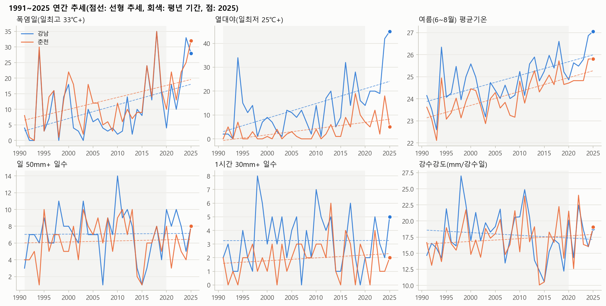

35년으로 보면 더위는 뚜렷한 추세이고, 비는 추세 없이 변동만 크다. 2025년 하반기는 평년 상위 10%를 넘는 이상고온일이 강남 44일, 춘천 46일(184일 중)이었고, 최고기온이 평년보다 1.6\~1.7℃ 높았다. 2025년 우리나라에 영향을 준 태풍은 0개라 태풍 효과는 이 데이터로 추정할 수 없다.

**60년으로 넓히면 비의 "양"이 아니라 "강도"가 늘었다(춘천 ASOS 1966\~2025).**

| 지표 | 10년당 변화 | 회귀 p / Mann-Kendall p | 1966\~1995 평균 | 1996\~2025 평균 | 변화 |
|---|---|---|---|---|---|
| 연강수량 | +12.9mm | 0.57 / 0.29 | 1,283mm | 1,367mm | +6.5% |
| 일 20mm+ 일수 | +0.23일 | 0.50 / 0.10 | 18.5일 | 19.9일 | +7.8% |
| 일 50mm+ 일수 | +0.18일 | 0.37 / 0.30 | 5.6일 | 6.5일 | +14.8% |
| **1시간 최다강수(연 최댓값)** | **+1.6mm** | **0.039 / 0.032** | 36.0mm | 42.3mm | **+17.5%** |
| **1시간 30mm+ 일수** | **+0.22일** | **0.029 / 0.022** | 1.1일 | 2.1일 | **+85%** |
| 강수강도(비 온 날 평균) | +0.38mm | 0.10 / 0.07 | 15.9mm | 17.3mm | +8.3% |

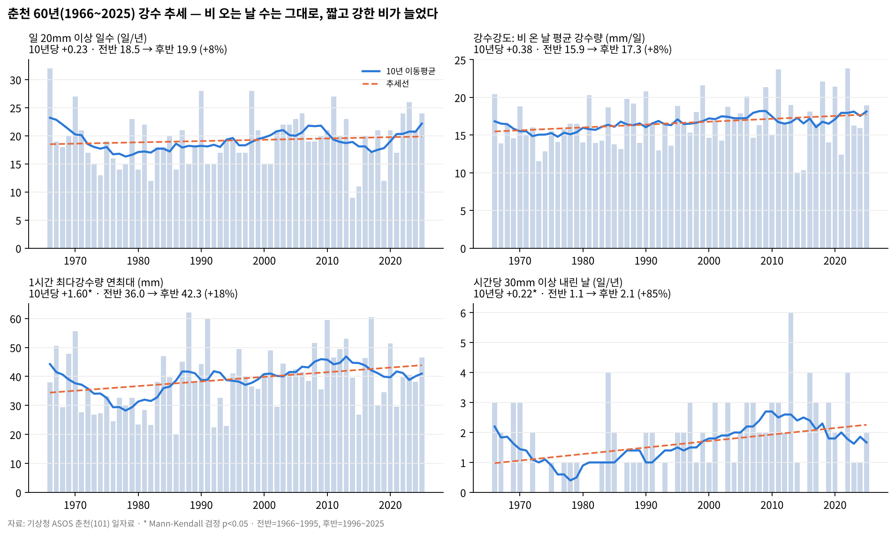

연강수량과 비 오는 날 수는 유의하게 변하지 않았다. 그러나 짧은 시간에 쏟아지는 비(1시간 최다강수, 1시간 30mm 이상 일수)는 회귀와 Mann-Kendall 두 검정 모두에서 유의하게 늘었다. 이는 기후 위기와 관련된 장기적인 강수 강도 증가 경향이며, 관측 추세만으로 원인을 특정하지는 않는다. 35년 창에서 1시간 30mm+ 추세가 보이지 않은 것은 기간이 짧아 연 1\~2일의 희소 사건을 가려내지 못했기 때문이다. 이 분석이 다루는 손실은 "영업시간에 오는 비"이므로, 비가 짧고 세게 오는 쪽으로 바뀌는 것은 손실이 커지는 방향이다. 다만 1시간 강수는 일 단위 매출과 직접 연결되지 않아, 손실 추정에는 영업시간 강수 합계를 쓴다.

### 3.2 2025년 하반기 이벤트와 시간대 구조

- **이벤트 일수**: 폭염일 강남 25, 춘천 30. 열대야 45, 6. 영업시간 비 10mm+ 17, 21(20mm+ 7, 13). 한파 춘천 3.
- **시간대**: 폭염 시간(체감 33℃ 이상)의 69%(강남)와 82%(춘천)가 12\~18시에 몰리고, 비의 34%는 0\~6시 새벽에 온다. 카드 매출은 12\~18시가 47\~50%, 18\~24시가 32\~33%이고, 유동인구는 12\~18시가 41\~42%다.
- **새벽 비**: 새벽에만 온 큰비(춘천 7/20 95mm, 9/13 63mm)에는 매출이 줄지 않았다. 비는 "온 시간대"가 중요하다는 것이 이 분석의 출발점이다.

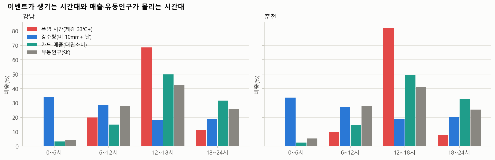

### 3.3 상권 구조

- **요일**: 춘천은 토요일에 몰린다(평일=100일 때 음식점 154, 주점 180, 숙박 170). 강남은 일요일에 빈다(음식점 79, 주점 42). 같은 비라도 춘천은 주말 비가 더 아프다.
- **외지인**: 춘천 소상공인 대면 매출의 20%가 외지인이고, 숙박은 76%, 여가·스포츠는 60%다. 관광데이터랩 기준으로 춘천 7\~12월 방문자 연인원은 1,510만\~1,615만 명이다. 관광소비의 92\~95%가 외지인이고, 방문자의 49%가 70\~140km(수도권 당일권)에서 온다.
- **연령**: 객단가는 나이가 들수록 커진다(춘천 여가·스포츠 10대 0.7만 → 60대 8.9만 원). 10대는 여가, 20\~30대는 카페, 고령층은 음식점 비중이 높다. 60대 이상 유동인구 비중은 춘천 24.7%, 강남 18.9%다.

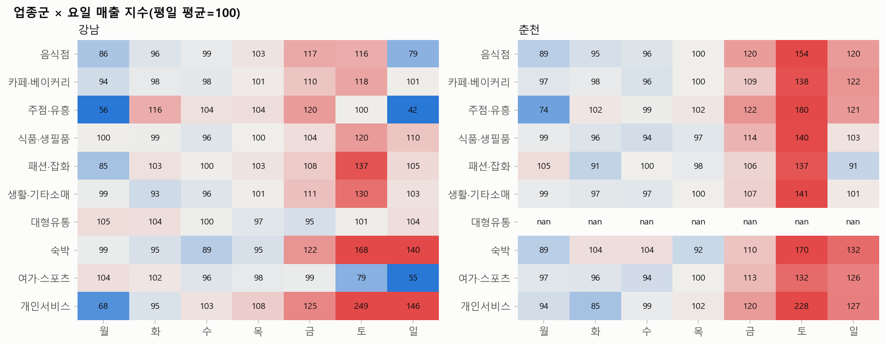

### 3.4 첫 발견 (기준선 편차)

- 영업시간 10mm 이상 비가 온 날 대면소비 매출은 춘천 −14%, 강남 −4%였다(같은 요일 ±1·2주 기준). 폭염일은 앞뒤 주 비교로는 효과가 보이지 않는다.
- 비 다음 날 반등은 없다(0%). 춘천은 비 전날부터 −3.6%다. 즉 비 온 날의 매출은 미뤄진 게 아니라 사라진 것이고, 취소 결정은 D-1에 이미 시작된다.
- 강남구 생활인구는 비 오는 날에도 줄지 않는다(3년 80일, −0.2%, 유의하지 않음). 손실은 "사람이 없어서"가 아니라 "있는 사람이 소비를 안 해서" 생긴다.

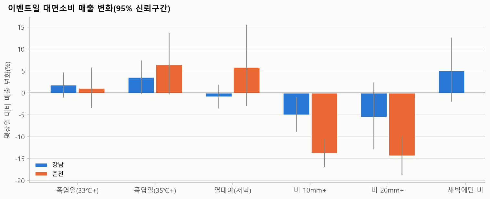

---

## 4. 모델: 선정, 평가, 해석

전체 구조는 이렇다.

- 민감도 모델(4.1)이 업종×시간대별 β를 준다.
- 취약 지수(4.2)가 β와 노출·적응능력을 합쳐 등급을 매긴다.
- 손실 산정(4.3)이 β를 금액으로 바꾼다.
- 그 위에 이벤트 발생 확률 모델(4.5)과 기상청 예보(4.6)를 얹어 시즌 기대 손실과 D-1 경보를 낸다.
- 기계학습 예측·분류 모델(4.4)은 이 구조 모델과 비교하려고 같이 만들었다.

날씨 자체를 예측하는 모델은 만들지 않았다. 기상청 예보보다 나을 수 없고, 우리가 평가할 것은 "예보가 상권 손실 예측에 쓸 만한가"이기 때문이다.

### 4.1 민감도 모델: 지역×업종(×시간대) 고정효과 회귀

**모형.** 시리즈(지역×업종)마다 다음 식을 추정한다.

`log(매출) = 요일 고정효과 + 주 고정효과 + 폭염일 + 열대야 + 비 10mm+ + 비 전날 + 비 다음 날 + 공휴일·연휴·추석·특별일 통제`

- 표준오차는 Newey-West(7일)다.
- 업종군·지역 값은 시리즈 계수의 역분산 가중 평균(정밀도 기준)과 매출 가중 평균(경제적 크기 기준)을 같이 보고한다.
- 시간대 패널은 그 시간대의 비(5mm 이상, 1\~5mm)와 더위를 쓴다. 연령군과 거주지(현지인/외지인)도 같은 식이다.

| 이벤트 | 춘천 | 강남 |
|---|---|---|
| 영업시간 비 10mm+ | −8.7% (매출 가중 −14.6%) | −5.7% (−11.3%) |
| 폭염일(33℃+) | +2.7% | +2.6% |
| 열대야 | +1.7% | −0.4% (−1.3%) |
| 비 전날 / 다음 날 | −3.6% / −0.6% | +0.4% / −0.3% |

- **강도(용량-반응)**: 1\~10mm −3%, 10\~20mm 춘천 −8%·강남 −3.5%, 20mm 이상 −9\~−11%다. 더위는 31\~33℃에서 −1.5%, 33℃를 넘으면 +1\~2%다. 같은 주의 덜 더운 날이 흐린 날이기 때문이다.
- **업종군(춘천, 비)**: 생활·기타소매 −17.5%, 패션·잡화 −14.4%, 숙박 −14.2%, 카페 −10.3%, 음식점 −9.0%다. 개별 업종으로는 골프장 −50%, 놀이동산 −37%, 화원 −30%다.
- **시간대**: 그 시간대에 5mm 이상 비가 오면 그 시간대 매출이 춘천 −9\~−13%, 강남 −8\~−10% 줄었다. 더위는 어느 시간대도 줄이지 않는다.
- **연령·거주지**: 춘천 60대 이상 −13.1%(10\~20대 −9.1%)다. 춘천 외지인 −14.7% vs 현지인 −9.2%이고, 강남은 −3.5% vs −6.7%로 차이가 없다. 레인체크 업종군(음식·카페·숙박·여가)의 춘천 외지인은 평일 −17.1%, 주말·공휴일 −18.6%로 요일 차이가 없다.

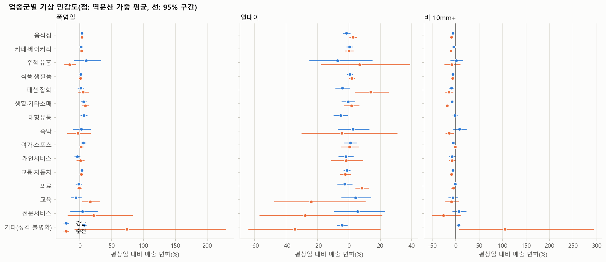

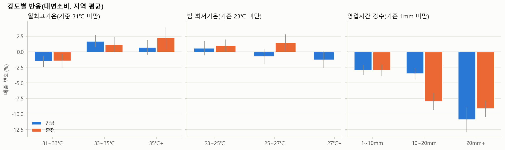

**평가와 강건성**

| 추정 방식 | 폭염(춘천/강남) | 호우(춘천/강남) |
|---|---|---|
| 기본 | +2.7 / +2.6 | −8.7 / −5.7 |
| 쿠폰 지급 직후 2주 제외 | +0.6 / +3.0 | −7.9 / −6.3 |
| 폭염 = 체감온도 33℃ | +0.7 / +0.9 | −8.9 / −5.7 |
| 특보 기준(폭염특보일, 호우특보 영업시간 발효일) | +1.7 / −3.2 | −7.0 / −3.9 |
| 이상기후 기준(평년 상위 10% 고온, 상위 5% 강수) | +1.9 / +0.9 | −4.4 / −4.0 |

- 어떤 정의로도 "비는 매출을 줄이고 더위는 줄이지 않는다"가 유지된다.
- 기준선 편차 방식(3.4절)과 회귀 결과가 같은 방향, 비슷한 크기라 두 방법이 서로를 검증한다.
- 한국은행 이슈노트(2025, 전국 일별 카드)는 폭염 −7%를 보고했는데, 강남·춘천 2025년 하반기에서는 폭염이 매출을 줄이지 않았다는 점이 다르다.
- 특보는 손실일을 못 잡는다. 손실이 난 비 오는 날 중 호우특보가 있었던 날은 강남 17일 중 6일, 춘천 21일 중 6일이다.

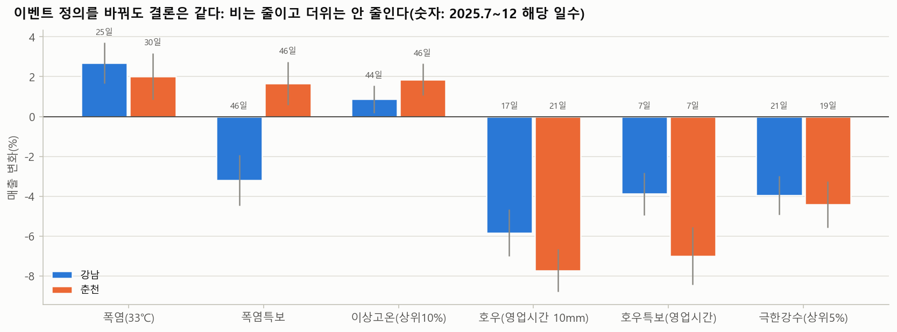

### 4.2 취약 지수

**식.** V = 민감도^0.5 × 노출^0.25 × (1 − 적응능력)^0.25. 윈저화 최소-최대 정규화 뒤 가중 기하평균으로 합친다.

- **민감도**: 회귀 계수를 경험적 베이즈로 지역 평균 쪽으로 축소하고, 증거가 있을 때(자체 p<0.10 또는 지역 평균이 유의하게 음수)만 센다.
- **노출**: 시간대별 매출 비중 × 이벤트의 시간대 분포다. 폭염·열대야는 여기에 60대 이상 고객 비중 × 지역 유동인구 60대 이상 비중을 더한다.
- **적응능력**: 비 다음 날 반등, 소상공인 중심 업종 여부, 외지인 결제 비중이다.
- **등급**: 대면소비 안에서 상위 25%는 취약, 상위 10%는 매우 취약이다.

**평가.** 216가지 설정으로 지수를 다시 만들었다(가중치 6종 × 결합 방식 2 × 윈저화 2 × 증거 규칙 3 × 등급 컷 3).

- 기본 설정 대비 순위 상관은 0.47\~1.0(평균 0.78)이다.
- 결과를 가장 흔드는 것은 증거 규칙(없애면 취약 집합의 65%가 바뀜), 그다음 가중치와 윈저화다. 등급 컷은 영향이 작다.
- 설정의 80% 이상에서 취약으로 남는 "확정 취약"은 춘천 7개(시계·귀금속, 화원, 가구, 세탁소, 중고품, 인테리어, 애완동물)이고, 강남은 없다(기타식품 77%).

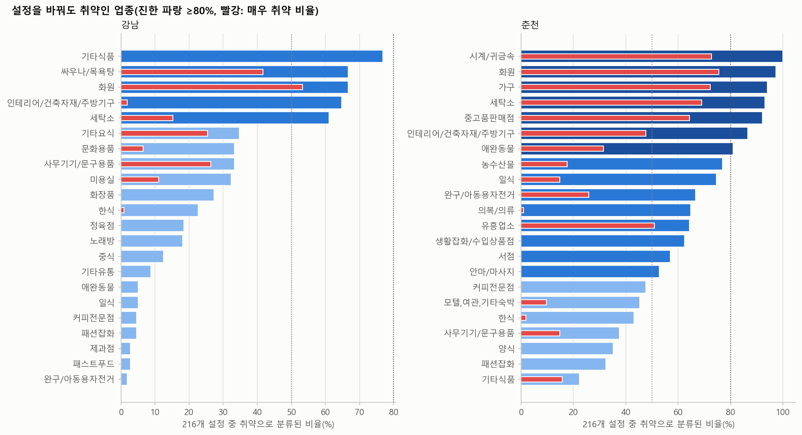

### 4.3 손실 산정

손실 = 이벤트일 매출 × (1 − e^β)이고, 감소가 확인된 시리즈만 센다. 하루당 평균 손실과 업소당 손실(상가정보 업소 수로 나눔)도 함께 낸다.

| 2025년 7\~12월 | 춘천 | 강남 |
|---|---|---|
| 소상공인 중심 대면 업종 손실 | 96억 원(매출의 1.3%, 전부 호우) | 204억 원(0.55%, 호우 203억) |
| 대면 업종 전체 | 171억 원(1.6%) | 480억 원(0.7%) |
| 대형 업종(판정 제외, 참고) | 골프장 40억(매출의 8.5%), 대형마트 26억 | 쇼핑몰 148억(열대야 131억, 한 시리즈), 대형마트 84억, 백화점 27억 |

- **업종군**: 손실액 1위는 음식점(춘천 51억, 강남 92억)이다. 손실률은 춘천 생활·기타소매와 개인서비스가 1.7%로 가장 높다.
- **업소 1곳 기준**: 호우일 하루 업소당 손실은 강남 서점 31만 원, 스포츠·레저용품 14\~17만 원, 춘천 가구 12만 원, 일식 11만 원이다. 음식점은 수만 원대다(춘천 한식당 하루 매출 44만 원, 비 오는 날 −5.5만 원). 업소당 정액보다 업종별 차등이 맞다는 근거다.
- **동 단위**: 지역×업종 손실을 동별 업소 수 비례로 나눴다.
  - 호우 하루 예상 손실 상위는 강남 역삼1동(2.2억)·압구정동·청담동, 춘천 퇴계동(0.56억)·석사동·강남동이다. 상위 3개 동이 지역 손실의 32\~36%를 차지한다.
  - 취약 업소 비율은 춘천 조운동 37%, 강남동 29%다.
  - 배분 가중치를 서울시 추정매출로 바꿔도 강남 상위 3개 동은 같다(순위 상관 0.94).
  - 동별 민감도는 카드가 시군구 단위라 측정할 수 없다. 동 값은 배분값이다.

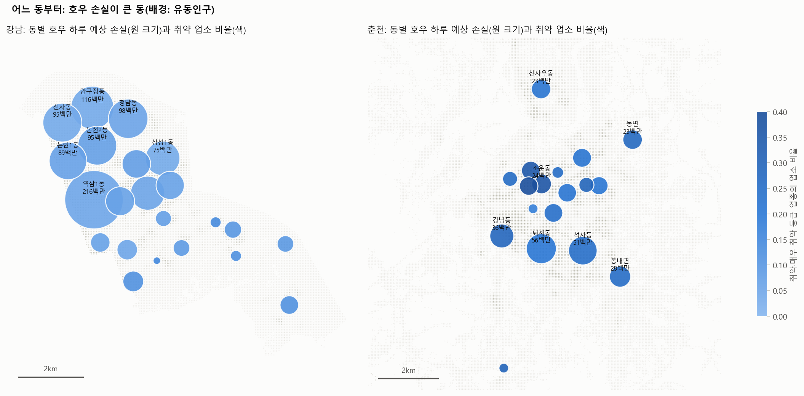

### 4.4 기계학습 예측·분류 모델과의 비교

**A. 일 매출 예측(LightGBM 회귀).**

- 목표 변수: `log(매출) − 직전 4주 같은 요일 평균`
- 피처: 달력, 7일 이상 지난 과거 매출, 업종 구조, 날씨(시간대별 강수, 최고·체감·밤 최저기온, 플래그, 다음 날 강수 = 예보 대리)
- 검증: 월 단위 교차검증(6겹)과, 7\~10월 학습 → 11\~12월 예측

| 월 단위 교차검증 | MAE(log) | WAPE | 비 10mm+ 날 편향 |
|---|---|---|---|
| LightGBM(날씨 포함) | 0.343 | 17.0% | −5.2% |
| LightGBM(날씨 제외) | 0.340 | 16.7% | +5.6% |
| 기준선(4주 같은 요일 평균) | 0.363 | 18.7% | +4.4% |

- 전체 오차는 세 모델이 비슷하다. 과거 매출이 예측의 대부분을 설명한다(SHAP: 과거 매출 > 업종·지역 > 달력 > 날씨).
- 날씨의 가치는 이벤트일 편향을 바로잡는 데 있다.
- 하이퍼파라미터 30개 조합을 탐색해도 기본값이 최적과 같았다. Ridge는 0.378, 지역별 분리 모델은 0.345다. 한계는 모델 구조가 아니라 데이터 길이(6개월)다.

**B. 이벤트일 경보 분류(LightGBM, 10% 이상 감소 여부, 날짜 GroupKFold).**

- ROC-AUC 0.68, PR-AUC 0.48(양성 33%), 상위 20% 정밀도 0.48이다.
- 단순 규칙 "춘천이고 비 10mm 이상"은 AUC 0.57, PR-AUC 0.38, 상위 20% 정밀도 0.48이다.
- 가장 강한 신호는 "춘천에 비가 오는가"이고, 모델은 업종·습도·기온으로 미세 조정한다.
- 확률 보정은 대각선 근처다. 놓침 비용이 헛경보의 3배면 비용 기준 임계값은 0.2다(경보율 79%, 재현율 94%).

**C. 손실 직접 예측.** 이벤트일 감소율을 LightGBM으로 직접 예측하면 회귀 β 방식보다 못하다(호우일 MAE 0.326 vs 0.317, 실제 감소율과의 상관 0.19 vs 0.25). 재현 실행에서 LightGBM 상관이 0.04에서 0.19로 달라졌고 원인은 확인하지 않았지만, 두 실행 모두 회귀 β가 앞선다(부록 재현 검증).

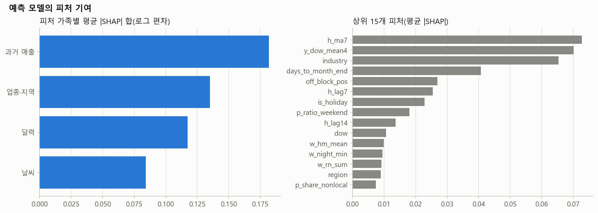

**선택: 구조 모델(β × 기준선)을 본체로 쓴다.**

- 성능이 비슷하면서 업종·시간대·금액으로 설명된다.
- 예보 입력이 그대로 들어가고, 매년 재추정이 쉽다.

기계학습 모델은 "날씨가 이벤트일 편향을 바로잡는다"와 "경보 신호의 핵심은 춘천의 비"를 교차 확인하는 데 썼다. 모델 예측에 비 온 날 강수를 0으로 바꿔 넣은 반사실 손실(춘천 123억, 강남 425억)은 회귀 기반 손실(170억, 346억)과 같은 자릿수다.

### 4.5 이벤트 발생 확률 모델

1991\~2025년 일자료로 계절 조화항 + 연도 추세 로지스틱을 만들었다. 1991\~2020년에 학습해 2021\~2025년으로 검증했다.

- 계절만 넣은 모델과 평년 빈도보다 Brier 점수가 낮다(강남 폭염 0.042 vs 0.046 / 0.047).
- 다만 최근 5년의 폭염·열대야 일수를 과소 예측한다(강남 폭염 연 13.7일 vs 실제 21.6일). 선형 추세가 최근 가속을 못 따라간다는 뜻이라 "최소 추정"으로 쓴다.
- 호우는 추세 계수가 0에 가깝다.

이 모델의 일별 확률 × 시리즈별 하루당 손실이 2026년 7\~12월 기대 손실 캘린더다.

- 강남 136억, 춘천 83억 원이다.
- 65%가 7\~8월에, 59%가 7월 13일\~8월 16일의 8주에 몰린다.
- 춘천 영업시간 호우일 기대값은 18.3일이다(7월 6.2, 8월 5.6, 9월 2.9…).

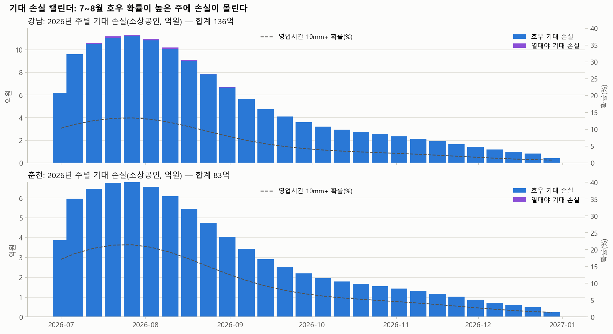

### 4.6 예보 적중 평가

기상청 API허브 동네예보 격자(강남 61,126, 춘천 73,134)의 전날 17시 발표분으로 2025년 7\~12월을 다시 돌렸다.

- **비가 올지는 맞히고 양은 못 맞힌다.** 영업시간 비 10mm+ 날을 예보 강수량 5mm 기준으로 보면 적중률 0.74, 헛경보율 0.59다(춘천 0.71, 0.57). 강수확률 60% 기준이면 적중률 1.00, 헛경보율 0.67이다. 강수량은 절대오차가 20\~24mm이고 관측과의 상관이 −0.26\~0.19라 금액 산정에 쓸 수 없다(20mm+ 적중률 0.30). 폭염일은 적중률 0.80, 헛경보율 0.31로 잘 맞는다.
- **순위 매기기에도 약하다.** 예보로 순위를 매기면 상위 10 업종의 손실 포함률이 55%로, 관측(59%)이나 규모순(58%)보다 낮다. 예보 오차가 민감도의 작은 이점을 지운다.
- **그래서 역할을 나눈다.** 경보(정보·행동 안내)는 예보로, 돈(지급 트리거)은 관측 확정으로 한다. 예보 5mm 경보가 호우일 손실의 강남 81%, 춘천 66%를 사전에 덮는다. 헛경보일의 실제 매출은 기준선 위라 헛경보의 비용은 안내 피로뿐이다.

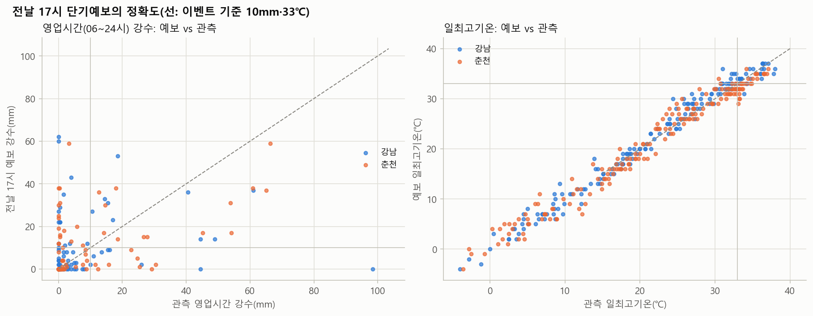

### 4.7 우선 지원 순위 알고리즘

**점수.** 예상 손실 = Σ 시간대별 (그 요일·시간대 평상 매출 × (1 − e^β_시간대)) + 폭염·열대야 일 β 손실. 경보 확률은 점수에 곱하지 않고 경보 여부로만 쓴다.

**백테스트(한 달씩 빼고 학습, 2025년 관측 호우일 21일, 지역-일 32건).**

- 예측 상위 10개 업종이 그날 실제 손실의 51.6%를 포함했다(규모순 51.0%, 확률순 19.1%, 무작위 18.1%).
- 시즌 누적으로는 춘천 70%(규모순 68%, 순위 상관 0.90 vs 0.76), 강남 56%다.
- 손실 금액 순위는 대부분 규모(평상 매출)가 설명하고, 민감도는 조금 보탠다.

알고리즘의 가치는 순위 자체가 아니라, 업종·업소당 예상 손실 금액과 경보를 함께 내서 지원 단가·대상·시점을 한 번에 정하는 데 있다.

**시나리오.** 춘천 토요일 30mm 호우 → 소상공인 예상 손실 5.9억 원(기타요식·한식·일식·스포츠용품·커피전문점). 강남 폭염 36℃ + 열대야 → 손실이 0에 가깝다.

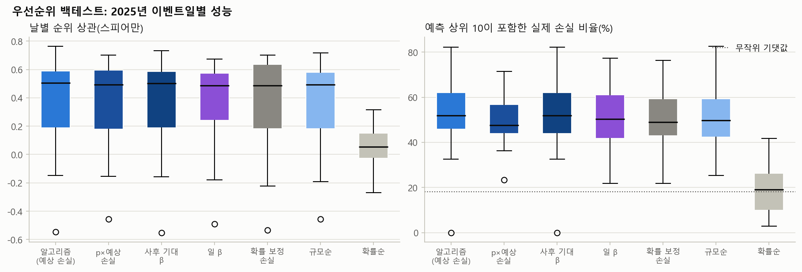

### 4.8 기후 시나리오

시나리오 손실 = 시리즈별 이벤트 하루당 손실 × 이벤트 일수다.

| 시나리오 | 강남 | 춘천 |
|---|---|---|
| 평년 이벤트 일수 | 134억 | 77억 |
| 2025년 실제 | 204억 | 96억 |
| 추세 연장 2035년 | 139억 | 88억 |
| 호우 +5일 | +59억 | +22억 |
| 폭염 +10일 | 변화 없음 | 변화 없음 |

호우일 하루당 손실은 강남 약 12억, 춘천 약 4억 원이다. 늘어나는 것은 폭염·열대야 일수인데, 이들은 소상공인 손실을 거의 만들지 않는다. 반면 비는 강도가 세지고 있다(3.1절). 따라서 기후 위기로 늘어날 손실을 줄이는 정책은 비에 집중해야 한다.

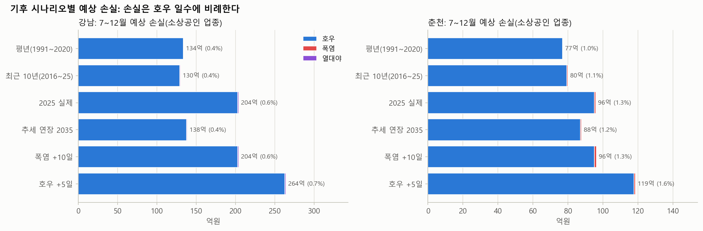

### 4.9 외지인 결제 모델: 레인체크를 위한 데이터·변수·모델

4.1\~4.6이 지역×업종 전체 매출을 다룬다면, 이 절은 레인체크가 겨냥하는 **춘천 외지인의 레인체크 업종 결제**만 따로 모델링한다. 목적은 세 가지다. ① 어느 업종의 외지인이 비에 민감한지, ② 날씨 정보가 외지인 결제 예측을 얼마나 개선하는지, ③ D-1 예보로 쿠폰 가발급 시점을 정할 수 있는지.

#### 4.9.1 데이터

| 데이터 | 단위·기간 | 쓰임 |
|---|---|---|
| 신한카드 데이터2 | 일 × 업종 × 고객 거주 시도, 2025.7\~12 | 외지인(강원 외 거주)·현지인(강원) 결제 건수·금액 |
| 기상청 ASOS 춘천(101) 시간자료 | 시간, 2025.6\~12 | 영업시간·시간대별 강수, 기온 |
| 기상청 단기예보(전날 17시 발표, 춘천 격자 73,134) | 일, 2025.7\~12 | 예보 강수량·강수확률·기온(4.6절과 같은 정리본) |
| 달력 | 일 | 요일, 공휴일(광복절·추석 연휴·성탄절), 민생쿠폰 지급 주간 |

대상 업종은 레인체크 사용처인 14개 업종(한식·일식·중식·양식·기타요식·패스트푸드, 커피전문점·제과점, 「모텔,여관,기타숙박」(카드 데이터상 1개 업종), 노래방·게임방/오락실·스포츠시설·영화/공연·싸우나/목욕탕)이고, 4개 업종군(음식점·카페·베이커리·숙박·여가)으로 묶었다.

#### 4.9.2 전처리

1. 데이터2를 춘천 가맹점 × 14개 업종으로 거르고, 고객 거주지가 강원·정보없음이 아니면 외지인으로 분류했다.
2. 업종 × 날짜 × 외지인/현지인으로 결제 건수와 금액을 합쳤다. 거래가 없는 날은 0으로 채웠다(14개 업종 × 184일).
3. ASOS 시간값은 카드 시간대에 맞춰 한 시간 당겼고(정시 값은 직전 1시간 누적), 06\~24시만 더해 영업시간 강수를 만들었다.
4. **타깃(기준선 편차)**: y = log(외지인 결제 건수 + 1) − 과거 4주 같은 요일의 평균. 기준선에서는 비 온 날(10mm+), 공휴일과 그 전후일, 쿠폰 주간을 뺐다. 과거 값만 써서 예측에 미래 정보가 섞이지 않는다. 기준선이 생기는 7월 15일부터, 지연 변수가 생기는 7월 22일부터 분석한다(2,016행, 영업시간 10mm+ 비 온 날 14일).

#### 4.9.3 변수

| 묶음 | 변수 | 비고 |
|---|---|---|
| 관측 날씨 | 영업시간 강수, 1시간 최대 강수, 시간대별 강수(06\~11·12\~17·18\~23), 새벽 강수, 최고·최저기온, 전날 강수, 3일 누적 강수 | 사후 분석·설명용 |
| 예보 날씨(D-1 17시) | 예보 영업시간 강수, 예보 1시간 최대, 강수 시간 수, 시간대별 예보 강수, 최대·평균 강수확률, 예보 최고·최저기온 | 운영(가발급)용 |
| 달력 | 요일, 주말·공휴일, 공휴일 전후, 쿠폰 주간 | |
| 업종 특성 | 외지인 결제 비중, 외지인 객단가, 주말/평일 결제비, 업종·업종군 | 정적 변수 |
| 지연 | 7일 전 편차 | 예측 시점에 알 수 있는 값만 |

#### 4.9.4 모델 1: 고정효과 회귀 — 어느 업종의 외지인이 비에 민감한가

`y = Σ 업종군 × 비 온 날(영업시간 10mm+) + 전날 강수 + 요일 + 공휴일·전후·쿠폰 + 업종 고정효과`, 결제 규모의 제곱근 가중, 주 단위 군집 표준오차.

| 업종군 | 외지인 | 현지인 |
|---|---|---|
| 숙박 | **−23.0%** (−33.1 \~ −11.4) | +2.0% (−11.0 \~ +16.9) |
| 카페·베이커리 | −11.9% (−20.2 \~ −2.8) | −13.8% (−18.5 \~ −8.8) |
| 음식점 | −9.5% (−17.6 \~ −0.5) | −11.7% (−19.6 \~ −3.1) |
| 여가 | **−7.7%** (−14.3 \~ −0.5) | −3.0% (−9.6 \~ +4.1) |

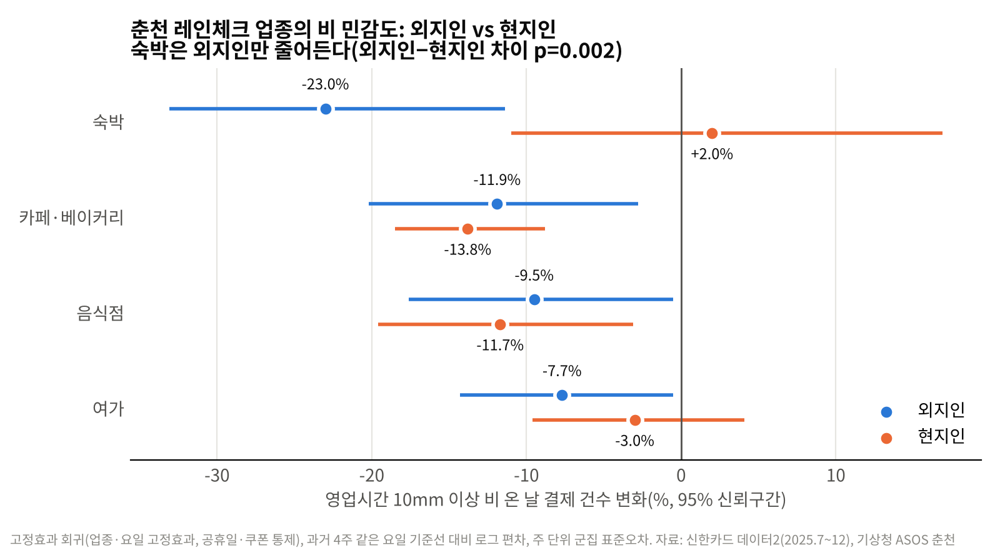

**외지인-현지인 차이 검정.** 외지인과 현지인 편차를 한 회귀에 쌓고 업종군 × 비 온 날 × 외지인 상호작용으로 두 집단의 차이를 직접 검정했다(같은 통제변수, 주 단위 군집 표준오차).

| 업종군 | 외지인 − 현지인 차이 | p |
|---|---|---|
| 숙박 | **−27.1%p** (표준오차 8.9) | **0.002** |
| 여가 | −3.9%p (4.0) | 0.33 |
| 음식점 | +3.6%p (6.1) | 0.55 |
| 카페·베이커리 | +3.2%p (6.0) | 0.60 |

음식점과 카페는 외지인과 현지인이 비슷하게 준다. **숙박은 외지인 감소가 현지인보다 유의하게 크다.** 여가는 외지인만 유의하게 줄지만, 두 집단의 차이 자체는 유의하지 않다. 비 오는 날 숙박 손실은 외지인 방문 취소·감소가 주요 원인일 가능성이 크다. 현지인 대상 지원으로는 이 손실을 되돌릴 수 없고, 외지인의 재방문을 유도하는 레인체크가 맞는 수단이라는 근거다. 숙박·여가의 결제 1회 상한을 2만 원으로 높인 설계(7.1.2)와도 맞는다.

#### 4.9.5 모델 2: 예측 모델 비교 — 날씨 정보가 무엇을 개선하나

평가는 월 단위 교차검증(한 달씩 빼고 학습해 그 달을 예측, 6겹)으로 했다. 지표는 외지인 결제 건수 기준 WAPE(전체·비 온 날)와 비 온 날 편향(예측 합 ÷ 실제 합 − 1)이다. LightGBM은 L1 손실, 300회, 잎 15개, 결제 규모의 제곱근 가중을 썼다.

| 모델 | 전체 WAPE | 비 온 날 WAPE | 비 온 날 편향 |
|---|---|---|---|
| 기준선(과거 4주 같은 요일) | 17.7% | 19.6% | +7.4% |
| LightGBM, 날씨 제외 | 16.2% | 21.5% | +10.3% |
| LightGBM, 관측 날씨 | 18.0% | 19.4% | +0.9% |
| **LightGBM, 예보(D-1)** | 17.1% | 18.1% | +2.1% |
| 고정효과 회귀, 관측 비 10mm | 16.9% | **17.2%** | −2.8% |
| 고정효과 회귀, 예보 5mm | 17.0% | 16.9% | +5.9% |

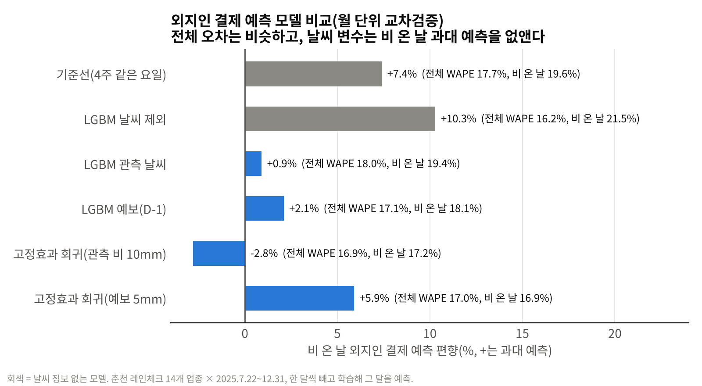

- **전체 오차는 모델 사이에 큰 차이가 없다**(16\~18%). 외지인 결제는 요일·공휴일·업종 규모가 대부분을 설명한다.
- **날씨의 가치는 비 온 날 편향을 없애는 데 있다.** 날씨가 없으면 비 온 날 외지인 결제를 7\~10% 과대 예측한다. 관측이나 예보 날씨를 넣으면 편향이 +1\~2%로 줄어든다. 전체 매출 모델(4.4절)과 같은 결론이 외지인에서도 성립한다.
- **D-1 예보만으로도** 관측 날씨를 쓴 모델과 비슷한 수준(비 온 날 WAPE 18.1%, 편향 +2.1%)으로 맞힌다. 레인체크를 예보로 미리 안내해도 된다는 근거다.
- 예보 모델의 SHAP 중요도는 7일 전 편차 > 공휴일 > 예보 최고기온 > 업종 > 예보 최저기온 > 예보 평균 강수확률 순이다. 예보 강수량보다 **강수확률**이 더 많이 쓰였다.
- 6개월 자료라 복잡한 모델의 이점이 작다. 설명이 쉬운 고정효과 회귀가 비 온 날 WAPE가 가장 낮아, 손실 산정은 회귀를 본체로 쓰는 팀 결정과 같다.

#### 4.9.6 모델 3: 예보 경보 평가 — 가발급 기준을 무엇으로 할까

레인체크는 전날 예보로 "내일 비가 오면 쿠폰이 나간다"고 미리 안내하고(가발급), 당일 관측 10mm로 확정한다. 가발급 기준을 고르기 위해 날짜 단위로 평가했다. 14개 업종 외지인 결제 합이 기준선보다 10% 이상 줄어든 날을 "손실일"로 봤다(공휴일·쿠폰 주간 제외 128일, 손실일 35일, 관측 10mm+ 16일).

| 가발급 기준(D-1 17시) | 경보 일수 | 관측 10mm 확정일 포착률 | 경보 중 실제 손실일 | ROC-AUC(손실일) |
|---|---|---|---|---|
| 예보 강수량 5mm 이상 | 21일 | 69% | 33% | 0.55 |
| **예보 강수확률 60% 이상** | 35일 | **100%** | 40% | **0.62** |
| LightGBM(예보 변수) | 25일 | 31% | 36% | 0.50 |
| 관측 10mm(사후, 참고) | 16일 | 100% | 44% | 0.62 |

- **강수확률 60% 기준이 2025년 하반기 확정일 16일을 모두 미리 잡았다.** 한 시즌 표본의 결과라 앞으로 모든 확정일을 잡는다는 뜻은 아니며, 매 시즌 다시 점검한다. 예보 강수량 5mm 기준은 확정일의 31%를 놓친다. 예보가 비가 올지는 맞혀도 양은 못 맞히기 때문이다(4.6절과 같은 결론).
- 가발급은 안내일 뿐이고 돈은 관측 확정 때만 나가므로, 헛경보의 비용은 알림 피로뿐이다. 따라서 **놓치지 않는 기준(강수확률 60%)**이 맞다. 경보 35일 중 확정은 16일이고, 나머지 19일은 "비가 덜 와서 쿠폰 없음"으로 끝난다.
- LightGBM 분류기는 날짜 128개로는 규칙보다 낫지 않았다. 운영에는 단순 규칙을 쓴다.
- 날짜 단위 손실일은 비 말고도 행사·계절 요인으로 생겨서, 관측 강수도 손실일 분류 AUC가 0.62에 그친다. 그래서 돈은 손실일이 아니라 관측 강수로 정하는 지수형 설계가 맞다.

**레인체크 설계 반영:** 가발급 기준을 "D-1 예보 영업시간 강수 5mm 이상"에서 **"D-1 예보 강수확률 60% 이상"**으로 바꾸기를 제안한다. 확정 기준(관측 10mm)은 그대로다.

#### 4.9.7 정리: 모델에서 제안으로

| 모델 결과 | 제안에 반영 |
|---|---|
| 숙박은 외지인만 줄어든다(−23%, 차이 p=0.002), 여가는 외지인만 유의(−8%) | 레인체크 대상은 외지인, 숙박·여가 상한 2만 원 |
| 날씨 없이 예측하면 비 온 날 외지인 결제를 7\~10% 과대 예측 | 비 오는 날 별도 대응이 필요하다는 근거 |
| 예보만으로 관측 수준에 가깝게 예측 | D-1 사전 안내 가능 |
| 강수확률 60%가 2025년 하반기 확정일 16일을 모두 포착 | 가발급 기준 = 강수확률 60% |
| 비 온 뒤 1주 안에 외지인 반등 없음(7.1.6) | 사중손실이 낮다 → 재방문 쿠폰의 여지 |

**한계:** 6개월, 비 온 날 14\~16일이라 업종군별 추정의 신뢰구간이 넓다. 카드 데이터는 신한카드 결제만 포함한다. 외지인은 카드 고객의 거주 시도로 정의해 강원 도내 다른 시군 방문객은 현지인으로 분류된다(외지인 효과는 보수적).

---

## 5. 취약 상권 결과

- **등급**:
  - 매우 취약(소상공인 중심): 춘천 화원·가구·인테리어·중고품·애완동물·완구·세탁소(모두 호우), 강남 화원·싸우나(열대야+호우).
  - 취약: 춘천 일식·농수산물·시계·귀금속·생활잡화·서점·커피전문점·의복·안마·패션잡화, 강남 기타식품·인테리어·세탁소.
  - 등급 분포(매우 취약·취약·보통·해당 없음): 춘천 7·9·18·6, 강남 2·3·37·0.
- **업소 수**: 취약 등급 업종의 업소는 춘천 3,061개, 강남 1,604개다. 강남 업소가 두 배 많은데도 취약 업소는 춘천이 두 배다. 2026년 기대 손실은 취약 등급 업소 기준 강남 9억, 춘천 22억 원이다.
- **누가 취약한가**: 춘천의 외지인·60대 이상·주말·야외 업종이다. 강남은 손실 금액은 크지만(동 하나가 춘천 전체와 맞먹음) 비율은 작고, 외지인과 현지인의 차이도 없다.
- **공간**: 손실 금액은 강남 역삼1·압구정·청담동, 춘천 퇴계·석사·강남동에 몰린다. 취약 업소 비율은 춘천 약사명동 53%, 조운동 37%, 소양동 36%가 높다. 60대 이상 유동인구는 강남 역삼1동(17만), 춘천 퇴계동(6.5만)에 집중되어 폭염 대응 위치의 근거가 된다.
- **지원 원칙**: "돈은 규모로, 대상은 취약도로"다. 예산 배분용 금액 목록과 현장 지원용 비율 목록을 따로 낸다.

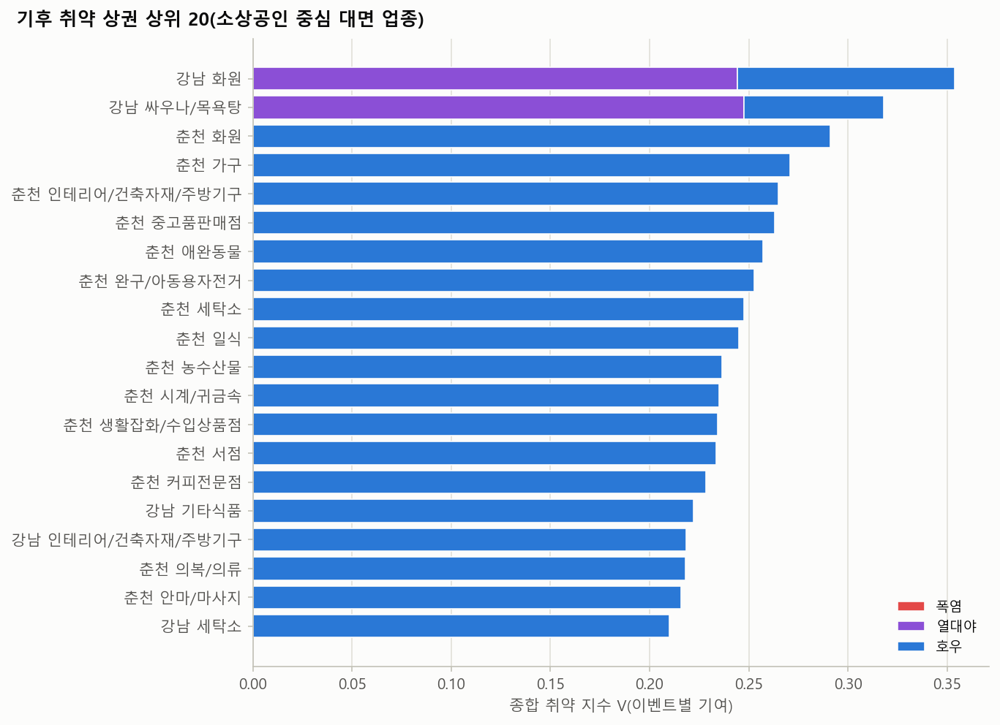

---

## 6. 골목 상권 정의와 시각화

### 6.1 기준과 방법

**법령 기준.**

- 전통시장 및 상점가 육성을 위한 특별법 시행령 제2조의2는 골목형상점가를 "2천㎡ 이내 면적에 소상공인 점포 30개 이상 밀집"으로 정한다. 같은 조 단서는 지자체 조례로 달리 정할 수 있게 한다.
- 춘천시 조례(2026.4.23 개정) 제24조는 이를 "2천㎡ 이내 소상공인 점포 15개 이상"으로 완화했다. 제25조는 상인 1/2 이상의 동의를 받아 신청하면 지정하도록 한다. 강남구도 2025\~2026년 조례로 완화했다.
- 법령은 밀도만 정하고 면적의 모양은 정하지 않는다. 그래서 법정 30개와 완화 15개를 모두 계산했다. 본 분석의 골목 상권은 **춘천 조례 기준(15개)**이다.

**방법.** 상가정보(2026.06) 업소 좌표로 각 업소 주변 2천㎡ 창 안의 업소 수를 센다.

- 창은 두 가지다.
  - 원형: 반경 25.2m(=√(2000/π))
  - 길 따라 직사각형: 업소가 늘어선 방향(반경 60m 이웃 좌표의 주성분)으로 돌린 100×20, 80×25, 63×32m 직사각형(모두 2천㎡) 중 최댓값
- 기준 이상이면 밀집 핵이다. 핵끼리 50m 이내면 같은 구역이고, 핵이 아닌 업소도 30m 이내면 구역에 넣는다.
- 한 건물이 구역 업소의 절반 이상이면 '단일 건물 구역'(상가 건물)으로 따로 두고, 골목 상권에서 뺀다.

**검증.** 지정·공식 상권의 업소가 후보 구역에 들어오는 비율로 확인했다. 길 따라 창이 뚜렷이 낫다.

| 대상 | 업소 | 원형(완화 15) | 길 따라(완화 15) |
|---|---|---|---|
| 강원대 후문 골목형상점가 | 180 | 37% | 72% |
| 뒤뜰 골목형상점가(삭주로) | 151 | 16% | 70% |
| 한림대 골목형상점가 | 55 | 4% | 4% |
| 강촌리(2026 지정) | 129 | 0% | 0% |
| 강남 공식 골목상권 54곳 안 업소 | 6,703 | 41% | 58% |

한림대와 강촌리처럼 2천㎡당 15개보다 성긴 상권은 어떤 창으로도 잡히지 않는다. 이런 곳은 밀도가 아니라 상인회 조직으로 지정된 것이므로 공식 목록을 그대로 쓰고, 우리 후보는 "요건을 만족하는 추가 후보"로 쓴다.

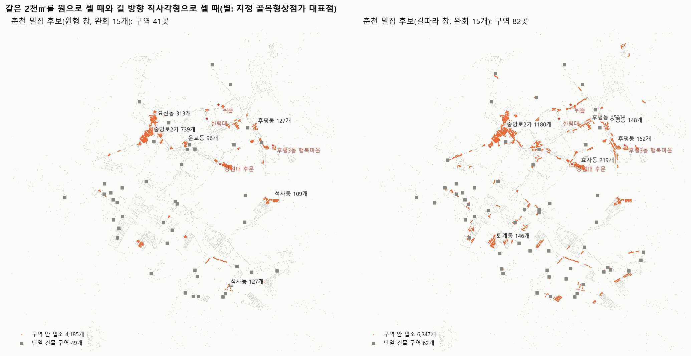

### 6.2 결과

| 기준·방법 | 지역 | 구역 수 | 업소 수 | 호우일 하루 손실(억) |
|---|---|---|---|---|
| **완화 15개, 길 따라 창(본 분석 기준)** | 춘천 | **82** | **4,445** | **1.2** |
| 완화 15개, 원형 창 | 춘천 | 41 | 2,579 | 0.7 |
| 법정 30개, 길 따라 창 | 강남 | 148 | 25,643 | 4.1 |
| 법정 30개, 원형 창 | 강남 | 107 | 11,634 | 1.9 |

- 춘천의 큰 구역은 명동·중앙시장권(중앙로2가, 업소 1,180개), 요선동 닭갈비골목, 운교동 먹자골목(음식 72%), 효자동 강원대 후문, 후평동이다.
- 구역별로 업소 수, 카드 업종 매핑 수, 음식 비중, 취약 등급 업소, 호우일 하루 손실, 20mm 기준 시즌 기대 지급액, 춘천사랑상품권 가맹률을 붙였다. 손실은 업종 단가를 업소 수로 나눈 배분값이지 구역별 측정값이 아니다.

| 호우일 하루 손실 상위 구역 | 행정동 | 업소 | 하루 손실 | 가맹률(하한) |
|---|---|---|---|---|
| 명동·중앙로2가 | 약사명동 | 1,180 | 3,508만 원 | 39% |
| 효자동(강원대 후문) | 효자3동 | 219 | 826만 원 | 39% |
| 운교동 | 조운동 | 137 | 562만 원 | 48% |
| 후평동 | 후평2동 | 152 | 497만 원 | 49% |
| 후평동 | 후평3동 | 152 | 421만 원 | 53% |

**춘천사랑상품권 가맹률.** 레인체크(7.1절)의 사용처가 상품권 가맹점이므로, 골목 구역 점포 중 가맹점 비율을 계산했다.

- 자료: 공공데이터포털 「춘천사랑상품권 가맹점 정보」(2025.11.19, 11,151곳)
- 방법: 상가정보와 가맹점 목록의 도로명주소(도로명 + 건물번호)를 맞추고, 같은 주소 안에서 상호명이 포함 관계이거나 유사도 0.6 이상이면 같은 점포로 봤다.
- 하한: 주소와 상호명이 모두 맞은 점포 비율이다. 골목 구역 **44%**(모바일 결제 가능 가맹점 기준 35%), 골목 밖 35%다. 업종별로는 음식 46%, 소매 50%, 숙박 26%, 예술·스포츠 25%이고, 구역별로는 12\~81%(중앙값 43%)다.
- 상한: 같은 건물에 가맹점이 하나라도 있는 비율로, 71%다.
- 가맹점 중 상가정보와 상호명까지 맞은 곳은 6,584곳(59%)이라 하한은 실제보다 낮다. 실제 가맹률은 44\~71% 사이로 본다.

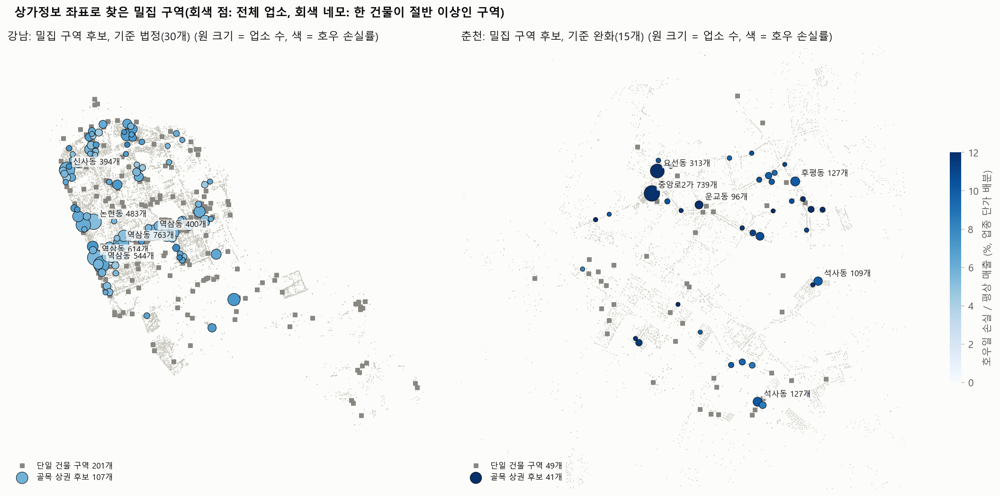

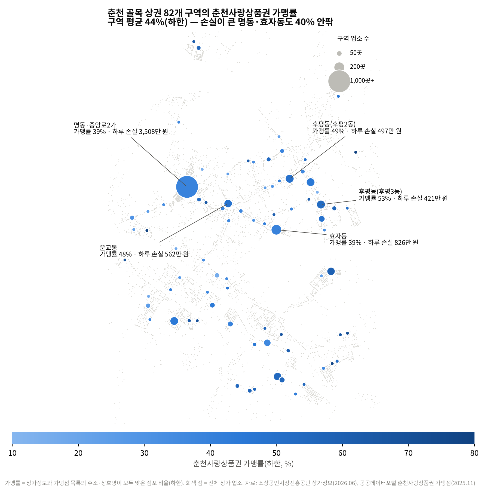

### 6.3 시각화: 상권 지도 (단일 HTML 데모)

- **강남**: 서울시 상권분석서비스 공식 상권 103곳(골목 54·발달 39·전통시장 9·관광특구 1)의 경계에 2025년 하반기 추정매출(합 5조 7,340억, 골목상권 3,017억), 점포 수, 길단위 유동인구, 집객시설, 상권 변화지표를 붙였다. 서울시 업종별 매출 × 우리 업종별 호우 민감도로 상권별 호우일 하루 손실을 냈다(발달상권 8.2억, 골목상권 1.2억, 전통시장 0.3억). 업소 수 배분값과의 상관은 0.93이다.
- **춘천**: 공식 상권 자료가 없어 우리 밀집 후보(원형·길 따라 두 레이어를 버튼으로 전환), 지정 골목형상점가 5곳, 전통시장 7곳, 지정 관광지 6곳, 읍면동 매출 구간(춘천시 상권 매출현황)을 올렸다.
- **기능**: 마우스를 올리면 점포 수, 면적, 매출, 유동인구, 호우 손실이 뜬다. 중요도 축(규모·취약도·회복력)을 고르면 그 기준의 상위 5\~15곳이 지도와 표에 번호로 표시된다. 가중 합이 아니라 축별 단일 지표 순위다. 배경은 SK 유동인구 격자와 행정동 경계이며, 외부 타일 없이 단일 HTML로 열린다.

---

## 7. 제안: 데이터로 만든 제도

세 제안을 잇는 원칙은 이렇다. 비 손실은 사람이 없어서가 아니라 있는 사람이 나오지 않아서 생긴다(3.4절). 그래서 당일 쿠폰으로 수요를 돈으로 사 오는 대신, 네 가지로 대응한다.

- **거래 유지**: 레인체크
- **손실 보전**: 우천 손실 지원금
- **비용 조정**: 예보 서비스
- **구조 다변화**: 핀포인트·캘린더

당일 우천 캐시백은 검토했지만 채택하지 않았다. 비 오는 날 나오지 않은 사람에게는 닿지 않고, 이미 나온 사람에게 주는 돈은 사중손실이 크기 때문이다.

| 제안 | 누구를 돕나 | 무엇을 메우나 | 주력 업종 | 트리거 |
|---|---|---|---|---|
| 7.1 레인체크 | 손님(외지인) → 가게 | 사라진 방문을 다음 방문으로 이연 | 음식·카페·숙박·여가 | 영업시간 10mm(관측) |
| 7.2 우천 손실 지원금 | 가게(소상공인) | 그날 잃은 매출의 절반 | 식품·소매·음식 | 영업시간 20mm(관측) |
| 7.3 예보 서비스 | 지자체·상인회·점포 | 재고·인력·예약 조정 | 전체 | D-1 예보 5mm |

### 7.1 제안 1. 레인체크: 비 때문에 놓친 춘천 방문을 뒤로 미루는 쿠폰

#### 7.1.1 왜 춘천인가

- 춘천 소상공인 대면 매출의 20%가 외지인이다.
- 레인체크 업종군(음식·카페·숙박·여가)의 외지인 매출은 비 10mm+ 날 −17\~−19%, 결제 건수는 −18\~−21% 줄어, 현지인(−9%)의 두 배다. 강남은 외지인과 현지인의 차이가 없다.
- 비 다음 날 반등이 없으니, "없어진 방문"을 "미뤄진 방문"으로 바꾸는 장치가 필요하다.
- 방문자의 49%가 70\~140km 당일권이라 다시 오는 비용이 낮다.
- 호우일 외지인 손실은 평균 1.6억 원/일이다. 2026년 기대 호우일 18일이면 약 29억 원이 레인체크가 겨냥하는 손실이다.

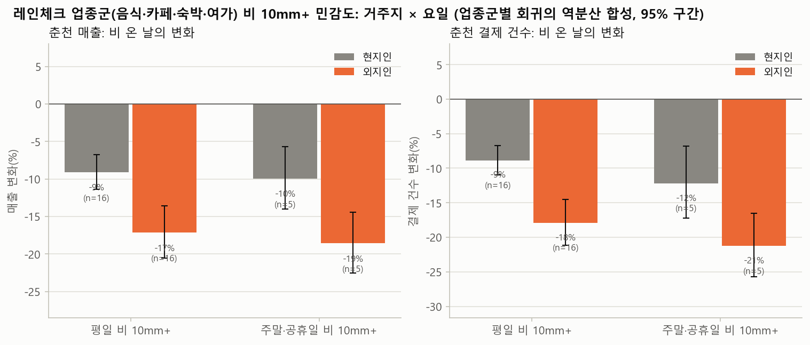

#### 7.1.2 설계

| 항목 | 설계 | 근거 |
|---|---|---|
| 트리거 | 가발급(사전 안내): D-1 17시 예보 강수확률 60% 이상. 확정(지급): 당일 관측 영업시간 강수 10mm 이상 | 10mm 확정이 비 온 날 외지인 손실의 83%를 덮고, 손실 없는 날은 0% 포함. 가발급은 돈이 나가지 않는 안내라 놓치지 않는 기준이 맞다. 강수확률 60%는 확정일을 100% 미리 잡고, 예보 강수량 5mm는 69%만 잡는다(4.9.6) |
| 발급 대상 | (1) 기본: 확정일에 춘천을 방문한 사람(춘천 가맹점 상품권 결제 또는 앱 위치 인증). (2) 확장: 14일 이전 예약 후 예보 발표 뒤 취소·변경한 사람(플랫폼 협약 시) | 2025년 트리거일 평균 외지인 결제는 평일 1.58만 건(기준선 1.89만, 사라진 3.1천), 주말 2.3만 건(3.1만, 사라진 8.2천) |
| 할인율(페이백) | 평일 20%, 주말·공휴일 10% | 요일별 민감도 차이는 없다. 차등의 근거는 평일 유도(주말 외지인 결제가 평일의 1.5배)와 비용 |
| 결제 1회 상한 | 식당·카페 1만 원, 숙박·여가 2만 원 | 외지인 건당 결제액 중앙값 2.5만 원, 숙박 평균 5.5만 원, 여가 6.9만 원. 일괄 1만 원이면 숙박 33%, 여가 30%가 상한에 걸려 실효 할인율이 12%, 8%로 떨어짐 |
| 횟수 | 월 2회 발급, 1일 3회 사용 | 7·8월은 트리거가 3일 이상일 확률이 95%라, 월 2회 상한이 매일 등록한 사람 기준 발급을 65\~68% 줄임 |
| 유효기간 | 8주 | 6주면 7·8월 발급분이 10월(연중 최대 방문 310만 명)에 닿지 못함. 8주면 8월 발급분이 닿음 |
| 월 한도·예산 | 지자체 전액 부담. 시즌 예산을 월별 기대 트리거 일수에 비례해 월 한도로 배분 | 7.1.6 |
| 사용처 | 춘천사랑상품권 모바일 가맹점 중 레인체크 업종. 골목 상권 82개 구역 가맹점은 앱 배너·가맹점 찾기에서 우선 노출 | 골목 구역 안 숙박업소는 43곳(가맹률 26%)뿐이라, 골목으로 제한하면 숙박·여가 혜택이 거의 없음(6.2절) |
| 지급 수단 | 춘천사랑상품권 앱 결제 시 요일·업종에 따라 자동 페이백 | 7.1.3 |

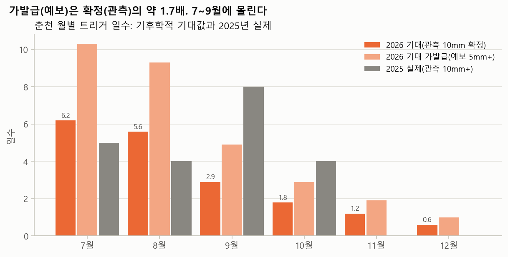

#### 7.1.3 왜 춘천사랑상품권인가: 이미 있는 것과 새로 만들 것

| 근거 | 내용 | 출처 |
|---|---|---|
| 발행·정책 주체 | 춘천시가 발행하고, 앱은 비즈플레이(제로페이 망)가 운영한다. 정책 설정은 발행 주체가 한다 | 앱 이용약관 제33조 1호 |
| 이미 있는 기능 | 쿠폰·선물 등록, 추가 적립금(포인트), 푸시 알림, 가맹점 찾기(위치 기반), 배너 | 앱 화면, 약관 제3조①3 |
| 외지인 사용 | 가입은 휴대폰 본인인증만 하고 주소를 받지 않는다. 조례상 사용자는 "구입하여 사용하거나 보유한 개인 또는 법인·단체"로 거주지 조건이 없다 | 앱 가입 절차, 춘천시 지역사랑상품권 조례 |
| 외지인 지급 근거 | "시장이 정하는 관광시설·문화시설·체육시설 이용자에게 상품권을 교부할 수 있다" | 조례 제9조 4항 |
| 악용 차단 | 무상 제공된 가치는 환불이 불가하고(제31조⑦), 재판매·양도가 금지된다(제34조) | 앱 이용약관 |
| 사용처 자동 한정 | 가맹 대상은 연매출 30억 원 이하 사업자다. 단란·유흥주점과 대규모·준대규모 점포는 등록이 제한된다 | 행안부 지역사랑상품권 지침(2023), 춘천시 조례 제6조④ |

지급 수단을 춘천사랑상품권으로 하면 돈이 춘천 소상공인에게만 흐른다. 새로 만들어야 하는 것은 두 가지뿐이다. ① 강수 트리거에 따른 적립 규칙, ② 방문 인증(위치 인증을 쓸 경우)이다.

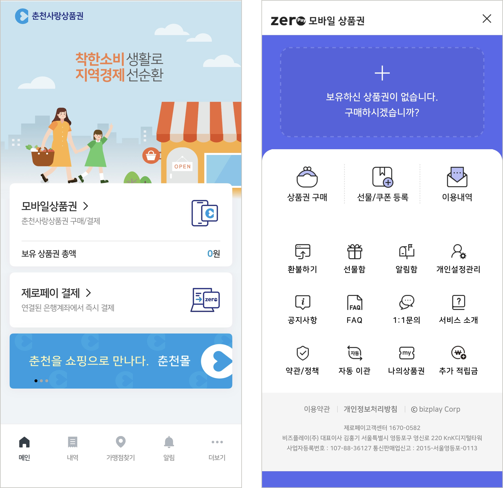

#### 7.1.4 앱에서의 작동 흐름

**기본안: 비 온 날 춘천을 방문한 사람**

1. **트리거 확정**: 당일 영업시간(06\~24시) 관측 강수 10mm 이상(기상청 ASOS 춘천)이면 시스템이 자동 판정한다.
2. **방문 인증**: 확정일에 춘천 가맹점에서 춘천사랑상품권으로 결제한 기록이 있으면 인증된다. 결제 없이 방문만 한 사람은 앱 위치 인증으로 받는다. 위치 인증은 구미시 K스탬프투어(GPS 자동 인증 후 구미사랑상품권 지급)와 같은 방식이다.
3. **발급**: 쿠폰 코드를 SMS·푸시로 보내고, 이용자가 앱의 쿠폰 등록 메뉴에 등록한다.
4. **사용**: 유효기간(8주) 안에 춘천사랑상품권으로 결제하면 앱이 요일·업종에 따라 자동 페이백한다. 상한과 1일 3회 제한도 앱이 적용한다.
5. **한도 관리**: 월 2회 발급, 월 예산 한도에 닿으면 그달 발급을 중단한다.

SMS 문자 자체를 쿠폰으로 쓰고 점포가 확인하게 하면 사용 횟수, 상한, 페이백을 관리할 수 없다. 앱에 등록하게 하면 이 조건을 모두 앱이 처리하고, 점포는 따로 할 일이 없다.

**확장안: 비 예보를 보고 예약을 취소·변경한 사람**

- 조건: 14일 이전에 예약하고, 예보(D-1 17시 강수확률 60% 이상) 발표 뒤 취소·변경한 사람이다.
- 숙박·관광 플랫폼과의 협약이 전제다. 시는 개인정보를 받지 않고, 플랫폼이 해당 고객에게 쿠폰 코드를 직접 보낸다. 이용자는 같은 방식으로 앱에 등록해 쓴다. 정부가 OTA를 통해 숙박 쿠폰을 배포하는 숙박세일페스타와 같은 구조다.
- 협약이 성사되지 않으면 기본안만으로 운영한다.

| 구분 | 이미 있음 | 새로 필요 |
|---|---|---|
| 춘천사랑상품권 앱 | 쿠폰 등록, 적립금, 알림, 가맹점 찾기 | 강수 트리거 연동 적립 규칙, 위치 인증 |
| 춘천시 | 상품권 예산·정책 설정 권한, 플랫폼 협력 경험(땡겨요) | 기상청 관측값 연동, 월 한도 관리 |
| 플랫폼(확장안) | 정부 쿠폰 발송 경험(숙박세일페스타) | 춘천시와의 협약 |

#### 7.1.5 사용처와 사전 작업

- **가맹 기준**: 춘천시 내 부가가치세법상 사업자로 연매출 30억 원 이하다. 신청서를 내면 시가 7일 안에 처리한다(조례 제6조①②⑤).
- **모바일 가맹점만 해당**: 레인체크는 앱으로 지급하므로 모바일 결제가 되는 가맹점에서만 쓸 수 있다. 가맹점 11,151곳 중 모바일 가능은 8,335곳(75%)이다.
- **골목 구역 가맹률**: 44\~71%(6.2절). 손실이 가장 큰 명동도 하한 39%다.
- **대형 시설 제외**: 레고랜드, 삼악산 케이블카 운영사, 골프장, 대형마트, 직영 프랜차이즈는 가맹점이 아니다. 레인체크의 여가 업종은 가맹점인 중소 레저·체험 업체를 뜻한다.

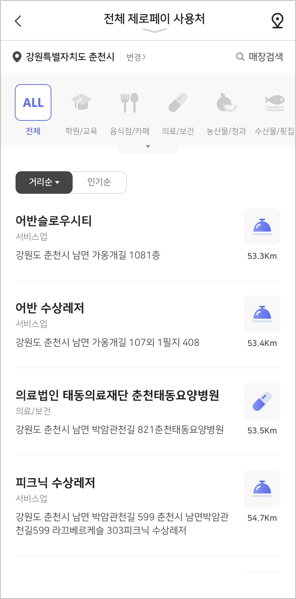

**사전 작업.** 시행 전 가맹률이 낮은 골목 구역부터 상인회와 행정복지센터를 통해 두 가지를 일괄 지원한다.

- 비가맹 점포의 가맹 등록
- 종이 상품권만 받는 가맹점의 모바일 결제 등록

근거는 지역사랑상품권 조례 제6조(등록)와 골목형상점가 조례 제24조④(가맹 권장)다. 구역별 가맹률은 시행 후 성과 지표로 함께 본다.

#### 7.1.6 예산과 효과

**단가(쿠폰 1장 기준).**

| 단가 | 값 | 산출 |
|---|---|---|
| 외지인 결제 1건 평균 | 37,462원 | 신한카드 데이터2, 레인체크 업종군 외지인 |
| 기대 사용 횟수 | 1회 | 사용률 50% × 사용 2회(가정) |
| 비용 | 5,303원 | 1회 사용 할인액(평일 20%·주말 10%, 주말 사용 30%, 업종별 상한 적용) × 1회 |
| 재방문 매출 | 37,462원 | 37,462원 × 1회 |
| 순증 매출 | 22,477원 | 37,462원 × (1 − 사중손실 40%, 아래 근거) |

**예산별 효과(시 전액 부담, 할인액만, 7\~12월 시즌).**

| 항목 | 시범 1억 원 | 본사업 3억 원 | 산출 |
|---|---|---|---|
| 쿠폰 발급 | 18,857장 | 56,572장 | 예산 ÷ 5,303원 |
| 쿠폰 사용자 | 9,429명 | 28,286명 | 발급 × 사용률 50% |
| 순증 방문자 | 5,657명 | 16,972명 | 사용자 × (1 − 사중손실 40%) |
| 재방문 매출 | 7.1억 원 | 21.2억 원 | 발급 × 37,462원 |
| **순증 매출** | **4.2억 원** | **12.7억 원** | 발급 × 22,477원 |
| 쿠폰 비용 대비 순증 매출 | 4.2배 | 4.2배 | 순증 매출 ÷ 예산 |
| **외지인 호우 손실 회복률** | **15%** | **44%** | 순증 매출 ÷ 29억 원 |

**월 발급 한도(1억 원).** 7월 6,389장, 8월 5,771장, 9월 2,988장, 10월 1,855장, 11월 1,237장, 12월 618장이다. 발급 총량을 월별 기대 트리거 일수 비중(6.2 / 5.6 / 2.9 / 1.8 / 1.2 / 0.6일)으로 나눴다. 3억 원이면 각각 3배다.

**한도가 필요한 이유.** 수요를 다 받으면 약 10.3억 원이 든다.

- 기본안 수요: 트리거일 외지인 12.8만 명 × 앱 인증 10%
- 확장안 수요: 사라진 방문 6.6만 명 × 플랫폼 연동 20%
- 두 수요의 인원을 합쳐 5,303원을 곱했다.

**사중손실 40%의 근거.** 사중손실은 쿠폰이 없어도 다시 왔을 방문의 비율이다. 두 방법으로 확인했다.

1. **카드 데이터: 비 온 뒤 자연 반등이 있는가.** 신한카드 데이터2에서 춘천 레인체크 업종의 외지인 일별 결제 건수(2025.7\~12, 184일)를 영업시간 10mm 이상 비 온 날(21일)과 그 전후 시차로 회귀했다. 통제변수는 요일·월·공휴일·민생쿠폰 기간이고, 표준오차는 Newey-West(7일)다.

| 비 온 날 기준 | 외지인 결제 건수 변화(표준오차) |
|---|---|
| 전날 | −4.8% (2.3) |
| 당일 | −15.1% (1.8) |
| 1\~3일 후 | +0.4% (2.3) |
| 4\~7일 후 | −2.0% (1.9) |
| 8\~14일 후 | +3.8% (1.6) |

비 온 뒤 1주 안에는 반등이 없다. 비 때문에 사라진 외지인 방문은 저절로 돌아오지 않으므로, 레인체크로 되돌릴 여지가 크다. 8\~14일 후 증가는 현지인에서도 비슷하게 나타나(+2.2%) 재방문보다 계절 효과로 보인다. 외지인−현지인 차이로 다시 추정하면 신뢰구간이 넓어, 6개월 자료로는 사중손실을 숫자 하나로 정하지 못한다. 비 전날 −4.8%는 예보를 보고 미리 취소한다는 뜻으로, 확장안(예약 취소자)의 근거가 된다.

2. **외부 실측.**
   - 한국관광공사 「2025 숙박할인권 지원사업 성과분석」(이용자 4만 2,366명 설문): 61.3%가 "계획에 없던 여행"을 떠났다. 나머지 약 39%는 할인권 없이도 갔을 여행으로 볼 수 있어 사중손실은 **약 39%**로 읽힌다. 여행 할인 쿠폰이라 레인체크와 성격이 가장 가깝지만, 설문 응답이고 대상·지역·쿠폰 방식이 달라 춘천 레인체크의 사중손실로 그대로 옮길 수는 없다. 기본값 40%가 이 수준과 비슷하다는 참고 근거로 쓰고, 실제 값은 시범에서 잰다.
   - KDI 1차 긴급재난지원금 분석(2020): 지원금의 26\~36%만 소비 순증으로 이어졌다. 사중손실 64\~74%로, 조건 없는 전 국민 현금 지원이라 **보수적 상한**으로 쓴다.

**사중손실별 효과(예산 1억 원).** 예산이 고정돼 있으면 사용률이 낮을수록 쿠폰을 더 많이 발급할 수 있다. 그래서 순증 매출은 사용률과 무관하고 사중손실에만 좌우된다(사용률 30%면 3.1만 장, 70%면 1.3만 장 발급).

| 사중손실 | 근거 | 순증 매출 | 비용 1원당 매출 | 손실 회복률 |
|---|---|---|---|---|
| 39% | 관광공사 숙박할인권 실측 | 4.3억 원 | 4.3원 | 15% |
| 40% | 본 분석 기본값 | 4.2억 원 | 4.2원 | 15% |
| 74% | KDI 재난지원금(상한) | 1.8억 원 | 1.8원 | 6% |

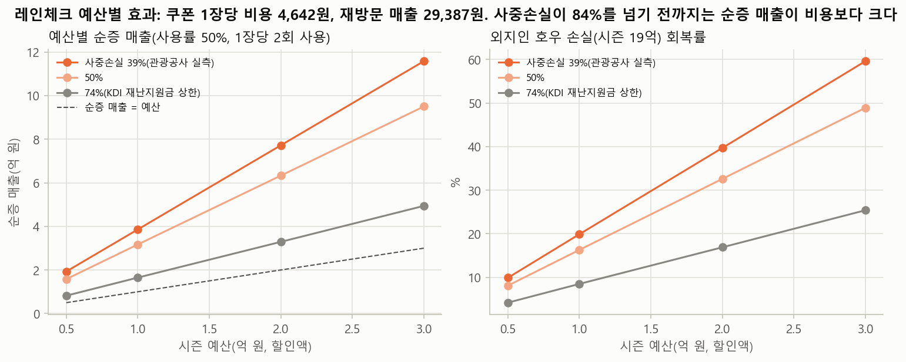

**쿠폰 비용과 순증 매출이 같아지는 점.** 사중손실이 86%(= 1 − 5,303 ÷ 37,462)를 넘어야 추정 순증 매출이 쿠폰 비용보다 작아진다. 참고 수준(39%)은 물론 보수적 상한(74%)에서도 순증 매출이 쿠폰 비용보다 크다.

**해석 주의.** 4.2억 원은 실측한 매출 증가가 아니라 기준 시나리오의 추정치다. 4.2배는 쿠폰 비용 대비 예상 순증 매출액의 비율이지 사회적 편익비용비(B/C)가 아니다. 순증 매출은 점포의 이익이 아니고 운영비도 빠져 있다. 따라서 86%도 재정사업의 경제적 손익분기점이 아니라 "매출 기준으로 쿠폰 비용을 넘는 경계"로 읽어야 한다.

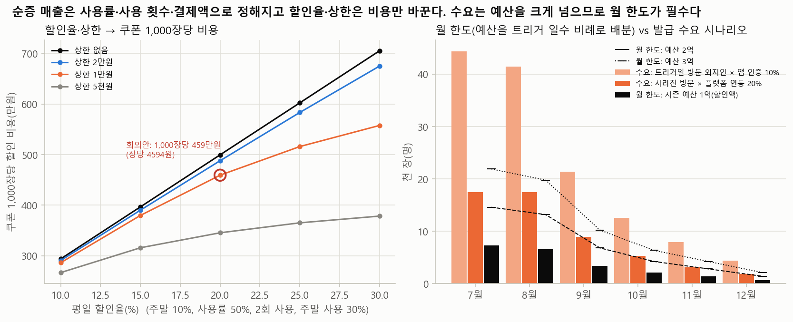

**시행 단계.** 2027년 7\~8월에 골목 2\~3개 구역에서 1억 원 규모로 시범을 한다. 사용률과 사중손실을 실측한 뒤 7\~12월 3억 원 본사업으로 넓힌다. 춘천시가 땡겨요 사업을 2024년 시범을 거쳐 2026년 전용 상품권으로 확대한 것과 같은 단계다.

**검증 설계.** 등록자를 발급군과 비발급군으로 나누거나, 등록자와 비등록 방문자를 비교한다. KPI는 다음과 같다.

- 발급 수, 사용률, 유효기간 내 재방문율과 소요 일수
- 평일 사용 비중, 사용 건당 결제액
- 제휴 점포의 우천일 매출 회복률, 사중손실 추정치, 골목 구역 가맹률

#### 7.1.7 선례와 차별점

| 사업 | 내용 | 레인체크에 주는 근거 | 레인체크와 다른 점 |
|---|---|---|---|
| 춘천 땡겨요 시범(2024.10\~12) | 공공 배달앱 쿠폰 지급. 춘천사랑상품권으로 결제하면 5,000원 쿠폰 추가 | 상품권 결제를 조건으로 한 보상을 춘천시가 이미 운영 | 날씨와 무관 |
| 춘천 땡겨요 전용 상품권(2026.10\~, 3개월 시범) | 15% 할인, 월 1억 원 발행, 매월 선착순, 예산 소진 시 조기 종료. 신한은행 운영, 춘천시 지원 | 플랫폼 협력, 월 한도, 시범 후 확대 | 배달 전용. 비 오는 날 배달은 오히려 늘어남 |
| 구미 K스탬프투어(2026.4\~11) | 관외 관광객이 명소에 가면 GPS로 자동 인증, 구미사랑상품권 1\~2만 원 지급 | 위치 인증 후 지역화폐 지급 | 날씨와 무관 |
| 숙박세일페스타(문체부·관광공사, 2026 여름) | 참여 OTA에서 숙박 할인 쿠폰 30만 장, 1박 2\~3만 원 | 정부와 플랫폼의 쿠폰 제휴 구조 | 날씨와 무관 |
| 혜택받GO! 강원여행(강원도, 2026) | 도외 관광객 영수증 환급(숙박 6만 원 이상이면 3만 원 등), 연 9억 원 | 외지인 직접 지급, 예산 규모 | 이미 온 사람을 보상. 비 손실과 무관 |
| 대전 온통대전 | 조건별 차등 캐시백 | 차등 페이백 운영 경험 | 월 한도가 없어 예산이 일찍 소진 |

**레인체크의 차별점.**

1. **날씨 연동**: 관측 강수로 자동 발동해 비 손실에만 반응한다.
2. **방문을 다시 일으킨다**: 기본안은 비 오는 날 방문한 사람에게 다음 방문 쿠폰을 줘 재방문을 유도하고(야구의 레인체크처럼), 확장안은 예보를 보고 예약을 취소한 사람의 사라진 방문을 되찾는다. 기존 사업은 방문한 사람에게 그 자리에서 보상하는 데서 끝난다.
3. **데이터로 정한 조건**: 트리거, 할인율, 상한, 유효기간을 카드 매출로 정했다.
4. **예산 통제**: 기상 확률 모델로 월 한도를 미리 배분해 조기 소진을 막는다.
5. **기존 앱 재사용**: 새 앱을 만들지 않는다.

### 7.2 제안 2. 골목상권 우천 손실 지원금

레인체크가 손님 쪽을 맡는다면, 이 제안은 가게 쪽의 당일 손실을 보완한다. 영업시간에 20mm 이상 비가 오면 춘천시가 골목상권 점포에 업종별 정액을 다음 날 지급하고, 지급 일수 11일과 총액 3억 원의 이중 상한을 둬 시범 예산을 최대 3억 원으로 고정한다.

#### 7.2.1 기존 장치의 빈자리

| 손실 종류 | 예 | 지금 보상하는 장치 |
|---|---|---|
| 시설·재고 피해 | 침수로 냉장고 고장, 재고 폐기 | 풍수해보험(정부 지원), 재난지원금(특별재난지역) |
| 영업 손실 | 비 때문에 손님이 안 와서 매출 감소 | 전통시장만 KB 날씨피해 보상보험. **골목상권은 없음** |

- 춘천 골목 82개 구역의 호우일 하루 손실은 1.2억 원이다(6.2절). 이 손실은 시설 피해가 아니라 풍수해보험 대상이 아니다. 재난지원금은 특별재난지역 선포가 필요해 일상적인 폭우에는 해당하지 않는다.
- 날씨보험은 2006년부터 있었지만 거의 팔리지 않았다. 현대해상은 출시 2년 만에 첫 계약이 나왔고, 삼성화재 연계보험은 가입 법인이 1곳이었다. 이유는 소멸성(비가 안 오면 낸 돈이 사라짐), 손실 입증의 어려움, 필요성 인식 부족이었다.
- 그래서 이 제안은 **보험이 아니라 시가 직접 주는 지원금**으로 설계한다. 점포는 내는 돈이 없어 소멸성 문제가 없고, 관측 강수만으로 자동 지급해 입증이 필요 없으며, 업종별 손실 수치로 필요성을 보여준다.

#### 7.2.2 KB 날씨보험과의 차별점

KB손해보험 「전통시장 날씨피해 보상보험」의 구조는 이렇다.

- 강수량·최고기온·최저기온 지수가 기준을 넘으면, 실제 손해와 무관하게 약정 보험금을 준다.
- 상인회나 지자체가 계약하는 단체보험이고, 시장 점포의 1/3 이상이 가입해야 한다.
- 배타적사용권이 2025.11.12\~2027.5.11이고, 금융감독원 2025 상생·협력 금융신상품 우수사례로 뽑혔다.

| 항목 | KB 전통시장 날씨피해 보상보험 | 골목상권 우천 손실 지원금 |
|---|---|---|
| 대상 | 전통시장 점포 | 골목상권 82개 구역(조례 기준). 전통시장 밖의 사각지대 |
| 성격 | 보험(보험료 납부) | 춘천시 지원금(점포 부담 없음) |
| 지급 기준 | 강수량·최고기온·최저기온 지수 | 영업시간(06\~24시) 관측 강수 20mm 이상. 밤비는 매출에 영향이 없으므로 제외 |
| 지급액 | 지수 구간별 약정 금액 | 업종군 × 평일/주말 차등. 카드 매출로 추정한 손실 단가의 50% |
| 비 적은 해 | 낸 보험료 소멸 | 점포 손해 없음(낸 돈이 없음) |
| 예산 통제 | 보험사가 위험 부담 | 지급 일수 11일 + 총액 3억 원 이중 상한으로 시 예산 고정 |
| 다른 정책과 연계 | 단독 | 레인체크와 짝(손님 쪽 + 가게 쪽) |

**영업시간 기준의 의미.** 하루 강수량 기준이면 새벽 3시에 30mm가 오고 낮에 맑아도 지급된다. 새벽 큰비에는 매출이 줄지 않았으므로(3.2절) 지급과 손실이 어긋난다(베이시스 리스크). 영업시간 10mm 기준은 비 온 날 외지인 손실의 83%를 덮고, 손실 없는 날을 포함하지 않았다.

**KB 상품과의 관계.** 같은 보험상품을 만들자는 제안이 아니다(KB 상품은 2027.5.11까지 배타적사용권이 있다). 지수형 보험의 장점(관측 지표만으로 자동 지급)을 지자체 지원금으로 옮긴 것이다.

#### 7.2.3 운영 흐름

| 단계 | 시기 | 내용 |
|---|---|---|
| ① 등록 | 매년 6월 | 골목형상점가 상인회(지정 시 상인 1/2 동의)가 점포 명단과 업종군을 일괄 등록. 지급 계좌 확인 |
| ② 판정 | 7\~12월 매일 | 기상청 ASOS 춘천 시간별 관측으로 06\~24시 강수 합계를 계산하고, 20mm 이상이면 발동 |
| ③ 지급 | 발동 다음 날 | 지급표 금액을 등록 점포 계좌로 입금. 신청·서류 없음 |
| ④ 상한 | 시즌 중 | 지급 일수 11일 또는 누적 지급액 3억 원에 먼저 닿으면 그 시즌 지급 종료. 3억 원에 닿는 날은 남은 금액을 그날 대상 점포에 지급표 비율대로 나눠 지급(사전 공표) |
| ⑤ 갱신 | 매년 | 카드 매출로 업종별 단가를 다시 추정해 지급표 갱신 |

D-1 예보 경보(7.3절)와 연결하면 "내일 20mm 이상 예상" 안내로 재고와 인력 조정도 함께 할 수 있다.

#### 7.2.4 지급표 (춘천, 영업시간 관측 강수 20mm 이상일 때 점포 1곳 하루 지급액)

| 업종군 | 점포 수(춘천) | 평일 | 주말 |
|---|---|---|---|
| 식품·생필품 | 870 | 4.7만 원 | 5.0만 원 |
| 생활·기타소매 | 1,131 | 3.1만 원 | 4.0만 원 |
| 음식점 | 4,722 | 2.0만 원 | 2.7만 원 |
| 패션·잡화 | 964 | 1.8만 원 | 2.1만 원 |
| 카페·베이커리 | 1,043 | 1.2만 원 | 1.5만 원 |
| 개인서비스 | 1,537 | 0.6만 원 | 0.6만 원 |

**산출(음식점 예).**

1. 업종별 손실 단가: 춘천 한식 점포 1곳의 20\~40mm 하루 손실은 평일 3.95만 원, 토요일 6.14만 원, 일요일 4.61만 원이다. 이 단가는 요일·시간대별 평상 매출 × (1 − e^β_시간대)을 관측된 비의 시간 분포로 가중하고 업소 수로 나눈 값이다(4.3·4.7절).
2. 업종군 평균: 음식점군 6개 업종(한식·일식·중식·양식·기타요식·패스트푸드)을 업소 수로 가중평균하면 평일 4.0만 원, 주말(토·일 평균) 5.4만 원이다.
3. 보전율: 50%를 곱해 평일 2.0만 원, 주말 2.7만 원이다.

**설계 이유.**

- **보전율 50%**: 단가가 업종 평균이라 개별 점포와 어긋나고, 평상 매출 변동도 섞인다. 100% 보전은 과잉 지급 위험이 있다.
- **구간을 "20mm 이상" 하나로**: 20\~40mm와 40mm 이상의 단가가 업종 95%에서 같다. 20mm를 넘으면 손실이 더 커지지 않으므로 구간을 나눌 필요가 없다. 10\~20mm 구간은 효과가 약하고(강남 −3.5%) 잡음이 커서 지급 근거가 약하다.
- **주말을 더 주는 이유**: 비 오는 날 매출 감소율은 요일과 무관하지만, 주말 평상 매출이 커서 잃는 금액이 크다. 레인체크의 평일 우대는 방문 분산과 비용 절감 목적이라 방향이 다르다.
- **매출은 지급표를 만들 때 한 번만 쓴다**: 지급 때는 관측 강수와 가입 업종군만 본다. 손실을 입증할 필요가 없고, 매출을 부풀릴 유인도 없다.
- **숙박·여가 제외**: 단가가 0.2\~0.4만 원으로 낮다. 이 업종의 손실은 외지인 감소(−17\~−21%)에 몰려 있어 레인체크가 맡는다.

#### 7.2.5 연간 지급 일수 상한: 왜 11일인가

보험과 달리 시가 직접 지급하면 비가 많은 해에 예산이 커진다. 그래서 시즌(7\~12월) 지급 일수에 상한을 둔다.

**1991\~2025 춘천 7\~12월 하루 강수 20mm 이상 일수**

| 일수 | 연도 수 |
|---|---|
| 9일 이하 | 2 (2014년 7일, 2015년 8일) |
| 10\~12일 | 11 |
| 13\~15일 | 9 |
| 16\~18일 | 11 |
| 19일 이상 | 2 |

하루 강수 기준 평균 14일을 영업시간 기준(4.5절 기대값 12.0일)으로 환산해(× 12/14) 상한별로 따져봤다.

| 상한 | 평균 지급 일수 | 상한에 걸린 해(35년 중) | 비 적은 해 지급 일수 |
|---|---|---|---|
| 8일 | 7.9일 | 33 | 6일 |
| 10일 | 9.6일 | 25 | 6일 |
| **11일** | **10.3일** | **22** | **6일** |
| 12일 | 10.9일 | 16 | 6일 |
| 15일 | 11.9일 | 5 | 6일 |

**근사 추정임을 밝혀 둔다.** 35년치 시간 단위 자료가 없어, 위 표는 하루 강수 20mm 이상인 날을 영업시간 기준으로 비율 환산(× 12/14)한 근사값이다. 2025년은 하루 20mm 이상 20일 중 영업시간 20mm 이상이 13일(비율 0.65)로 12/14(0.86)보다 낮았다. 실제 영업시간 기준이면 상한에 닿는 해는 이 표보다 적을 수 있다.

- **일수 상한은 11일로 한다.** 시범 3개 구역의 평균 하루 지급액이 0.263억 원이라 3억 원 ÷ 0.263억 원 ≈ 11.4일이다. 평균 지급 일수는 10.3일로 상한이 없을 때(기대 12일)의 86%다.
- **요일에 따라 하루 지급액이 다르다.** 지급표가 주말에 더 주므로 시범 3개 구역의 하루 지급액은 평일 0.245억 원, 토요일 0.359억 원, 일요일 0.262억 원이다. 그래서 평균 하루 지급액 × 11일(2.9억 원)이 엄밀한 최댓값은 아니다. 11일이 모두 토요일이면 이론상 3.95억 원이다.
- **35년 요일 모의.** 1991\~2025년 7\~12월에 하루 강수 20mm 이상인 날을 날짜 순으로 11일까지 고르고 그날 요일의 지급액을 더했다. 연 지급액은 평균 2.83억 원, 최소 1.73억 원, 최대 3.20억 원이었고, **35년 중 5년이 3억 원을 넘었다.**
- **그래서 총액 상한을 같이 둔다(이중 상한).** 지급 일수 11일과 누적 지급액 3억 원 중 먼저 닿는 쪽에서 지급을 끝낸다. 3억 원에 닿는 날은 남은 금액을 그날 대상 점포에 지급표 비율대로 나눠 주고, 이 규칙을 사업 공고에 미리 밝힌다. 이렇게 하면 **시범 예산은 엄밀하게 3억 원을 넘지 않는다.** 35년 모의에서 이중 상한 적용 후 평균 지급액은 2.82억 원이다.
- 같은 상한을 모든 등록 점포에 적용하므로, 예산이 먼저 떨어진 순서로 지급이 끊기는 선착순 방식보다 공정하다.
- 시범 결과(지급과 실제 매출 감소의 일치도)를 보고 2단계에서 상한을 늘리거나 대상 구역을 넓힌다.

**점포 1곳이 받는 돈(시즌, 11일 기준, 평일·주말 평균 비율로 근사)**

| 업종군 | 평균 | 11일 지급 시 | 비 적은 해(6일) |
|---|---|---|---|
| 식품·생필품 | 48.8만 원 | 52.2만 원 | 28.4만 원 |
| 생활·기타소매 | 34.5만 원 | 36.9만 원 | 20.1만 원 |
| 음식점 | 22.7만 원 | 24.2만 원 | 13.2만 원 |
| 패션·잡화 | 19.3만 원 | 20.6만 원 | 11.2만 원 |
| 카페·베이커리 | 13.2만 원 | 14.1만 원 | 7.7만 원 |
| 개인서비스 | 6.1만 원 | 6.5만 원 | 3.5만 원 |

산출: 12일 기준 수령액 = 평일 단가 × 8.1일 + 주말 단가 × 3.7일(평일·주말 비율은 레인체크 트리거 12.4 : 5.7). 평균은 × 10.3/12, 최대는 × 11/12, 비 적은 해는 × 6/12. **이 표는 일수 상한(11일)만 반영한 근사치이며, 총액 상한(3억 원)에 따른 비례 감액은 반영하지 않았다.** 총액 상한에 닿는 해(35년 모의 중 5년)에는 마지막 지급일의 금액이 비례로 줄어 실제 수령액이 이보다 조금 적다.

#### 7.2.6 규모와 춘천시 부담

| 범위 | 구역 업소 | **지급 대상 점포** | 하루 지급액(평일 / 토 / 일) | 시즌 평균 | **시즌 최대** |
|---|---|---|---|---|---|
| **1단계 시범**: 손실 상위 3개 구역(명동·효자동·운교동) | 1,536곳 | **1,220곳(79%)** | 0.245 / 0.359 / 0.262억 원 | 약 2.8억 원 | **3.0억 원(총액 상한)** |
| 2단계 확대: 골목 82개 구역 전체 | 4,445곳 | 3,123곳(70%) | 시범의 약 2.3배 | 약 6.5억 원 | 6.9억 원(총액 상한) |

- **지급 대상 점포.** 지급표 업종군(식품·생필품, 생활·기타소매, 음식점, 패션·잡화, 카페·베이커리, 개인서비스)에 들어가 카드 업종 단가가 있는 점포만 지급한다. 시범 3개 구역 1,536곳 중 316곳은 단가가 없어 1단계에서 빠진다. 의원(61곳), 종합 소매(41곳), 사진 촬영(28곳), 의약·화장품 소매(28곳), 안경(22곳), 가전·통신 소매(18곳) 등이다. 의원·전문 서비스처럼 비 손실이 작을 업종은 계속 제외하고, 소매 업종은 2단계에서 카드 업종 단가를 추정해 편입 여부를 정한다.
- 산출: 지급 대상 점포의 업종별 하루 손실 단가(20\~40mm, 평일·토·일) × 50%를 더해 요일별 하루 지급액을 구했다. 시즌 평균은 35년 요일 모의의 이중 상한 적용 평균이다. 2단계는 시범과 같은 방식으로 업종 구성 비율(7.27 ÷ 3.16 ≈ 2.3배)을 곱해 근사했다.
- **시 예산은 총액 상한(시범 3억 원)으로 편성한다.** 남은 예산은 이듬해로 넘기거나 레인체크 예산에 보탠다.
- 레인체크 시범(1억 원)과 합치면 시범 단계 춘천시 예산은 **연평균 약 3.8억 원, 최대 4.0억 원**이다(예보 서비스 구축비 등 운영비 제외).

**춘천시 재정 여건.** 춘천시 2026년 본예산안은 1조 7,040억 원이고, 지역경제 분야에 춘천사랑상품권 38억 원, 중소기업 육성 지원 31억 원, 전통시장 활성화 13억 원이 편성됐다(2025.11 발표, 이후 추경과 다를 수 있음). 시범 최대 3억 원은 전체 예산안의 약 0.018%, 춘천사랑상품권 예산의 약 7.9%다. 전체 예산에 비하면 작지만 소상공인 개별 사업에 비하면 작지 않으므로, 기존 사업 예산을 돌려 쓰는 것이 아니라 **별도 시범사업으로 신규 편성**하는 것을 전제로 한다. 시행에는 지급 근거(조례 또는 사업 근거), 소상공인 지원 세부사업과의 연계, 신규 예산 편성과 시의회 심의가 필요하다.

| 단계 | 대상 | 예산 | 재원 | 운영 |
|---|---|---|---|---|
| 1단계 시범 | 명동·효자동·운교동(지급 대상 1,220곳) | 연 최대 3억 원(11일 + 총액 이중 상한) | 춘천시 자체 예산(신규 편성) | 지급과 실제 매출 감소의 일치도 검증 |
| 2단계 확대 | 성과에 따라 골목 구역 확대 | 성과 평가 후 증액(82개 구역 최대 6.9억 원) | 춘천시 예산 | 상한·대상 단계적 조정 |

### 7.3 제안 3. 우천 손실 예보 서비스와 폭염 건강 안내

- **엔진**: 입력은 전날 17시 단기예보이고, 계산은 Σ 시간대별 평상 매출(요일) × (1 − e^β)이다.
- **출력**:
  - 내일 경보판(업종별 확률·예상 손실)
  - 시나리오 시뮬레이터(요일 × 시간대 강수 × 더위)
  - 손실이 몰리는 동
  - 시즌 예산 캘린더
  - 업종 카드("내 업종은 비 오면 −13%, 하루 5.5만 원")
  - 손실 단가표와 트리거 기록
- **운영**: D-1 17시 예보 수신 → 경보 업종·예상 손실 산출 → 담당자 대시보드와 상인회·업소 문자 발송(재고·인력·예약 조정, 배달 전환 안내) → D-day 관측으로 레인체크·지원금 트리거 확정 → 시즌 뒤 민감도 재추정. 경보 문턱은 지자체가 비용비로 고른다(놓침 : 헛경보 = 3 : 1이면 임계값 0.2).
- **폭염은 건강 지표로 다룬다.**
  - 2025년 폭염일 하루 평균 온열질환자는 서울 8.7명(폭염 아닌 날 1.3명), 강원 3.3명(0.7명)이고, 35℃ 이상이면 서울 14명이다.
  - 2011\~2025년 연도별 폭염일수와 환자 수의 상관은 0.85(서울), 0.91(강원)이다.
  - 폭염 예보(적중률 0.80)가 뜨면 온열질환 예상 환자와 쉼터·냉방·영업시간(12\~18시) 안내를 같은 화면에 띄운다.
  - 고령 유동인구가 몰리는 강남 역삼1동과 춘천 퇴계동이 우선 위치다.
- **사용자별 화면**: 지자체 담당자(경보판·예산), 상인회·점포(업종 카드·D-1 안내), 지원금 담당자(지급표·트리거·지급 기록).

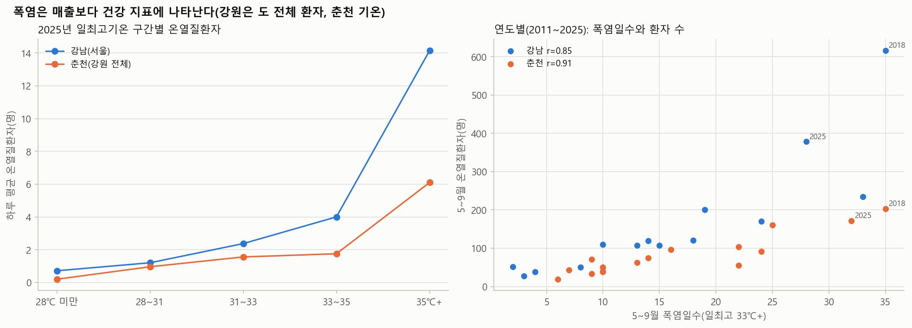

### 7.4 공통: 동×업종 핀포인트와 시즌 예산 캘린더

- **금액 목록(예산 배분)**: 강남 역삼1·압구정·청담동, 춘천 퇴계·석사·강남동
- **비율 목록(현장 지원)**: 춘천 약사명동·조운동·소양동
- **골목 목록(레인체크 우선 노출·보장 시범)**: 명동(중앙로2가)·효자동·운교동
- **시기**: 2026년 7\~12월 기대 손실(강남 136억, 춘천 83억 원)의 59%가 7월 13일\~8월 16일 8주에 몰린다. 지원 예산, 인력, 상인회 안내를 이 기간에 미리 배치하고, 기후학적 확률 모델로 매년 갱신한다.

---

## 8. 실효성과 한계

### 8.1 실효성

- **필요한 자료가 적다.** 카드 매출(시군구×업종×일)과 기상청 관측·예보만 있으면 돌아간다. 다른 시군구는 같은 파이프라인에 카드 자료만 바꿔 넣으면 되고, 매년 민감도와 단가표를 다시 추정한다.
- **법·제도 근거가 있다(지원금은 일부).**
  - 레인체크: 지역사랑상품권 조례 제6조·제9조 4항, 앱 이용약관(쿠폰·적립금·환불 제한), 땡겨요·구미·강원도 선례
  - 골목 상권: 전통시장법 시행령 제2조의2와 춘천시 조례 제24·25조
  - 지원금: 지원 대상의 제도적 근거는 확인했다(춘천시 골목형상점가 조례의 지정·상인회 구조). 날씨 지수형 정액 지급 방식은 KB 상품에서 운영되고 있다. 다만 춘천시가 날씨 지수에 따라 정액 지원금을 직접 지급할 수 있는 별도 사업 근거(조례 또는 사업 근거)는 추가 검토가 필요하다(8.3절).
- **이미 있는 것을 쓴다.** 레인체크는 기존 춘천사랑상품권 앱의 쿠폰 등록·적립금 기능을 쓰고, 지원금은 공개 기상 관측만으로 판정하고 상인회 명단으로 지급한다.
- **비용이 통제된다.** 레인체크는 장당 기대 비용 × 월 한도로, 지원금은 20mm 트리거·보전율 50%·지급 일수 11일과 총액 3억 원의 이중 상한으로, 예보 서비스는 경보 문턱으로 지자체가 지출을 고를 수 있다. 시범 단계 춘천시 예산은 연평균 약 3.8억 원, 최대 4.0억 원으로 시 전체 예산안(1조 7,040억 원)의 약 0.02%다.
- **가정이 틀려도 견딘다.** 레인체크는 사중손실 86%까지 추정 순증 매출이 쿠폰 비용보다 크다(B/C가 아닌 매출 기준). 지원금은 상한 덕분에 비가 많은 해에도 예산이 최대치를 넘지 않는다.
- **검증이 설계에 들어 있다.** 레인체크 시범의 발급군·비발급군 비교, 경보 적중률·헛경보율, 트리거 발생 후 지급 소요일, 지원이 포착한 실제 손실 비중, 취약 등급 업종 폐업률 변화, 골목 구역 가맹률을 본다.

### 8.2 한계

- **기간이 짧다.** 카드 기간이 6개월이라 민감도는 2025년 하반기 값이다. 태풍 직접 영향 사례가 없고 한파는 3일이다. 다년 자료로 보정해야 한다.
- **공간 값은 배분값이다.** 동·구역 단위 손실은 측정값이 아니라 업소 수 비례 배분값이다. 상가정보는 2026년 6월 기준이고, 신한카드 가맹점이 아닌 전체 등록 업소다.
- **폭염 효과는 보수적이다.** "같은 주의 덜 더운 날" 대비로 쟀고, 전통시장·노점은 카드에 안 잡혀 폭염 손실이 숨어 있을 수 있다. 열대야 손실은 강남 쇼핑몰 한 시리즈에 의존한다.
- **가정값이 있다.**
  - 소상공인 여부는 업종 단위 판단이다.
  - 레인체크의 사용률(50%)과 재방문 주기는 자료가 없어 가정했다. 사중손실(40%)은 외부 실측(39%)과 맞췄지만 춘천 레인체크 자체의 값은 시범에서 재야 한다. 주말 비 표본은 5일이고, 방문자 환산은 상한이다.
- **베이시스 리스크가 남는다.** 지원금은 업종 평균 단가라 개별 점포의 실제 손실과 어긋날 수 있다. 35년 강수 검증은 하루 강수 기준이라 영업시간 최소 일수는 근사값이다.
- **가맹률은 범위로만 알 수 있다.** 상호명 매칭이 불완전해 가맹률은 44\~71% 범위로 제시했다. 골목 점포의 30%(시범 3개 구역은 21%)는 카드 업종 단가가 없어 1단계 지급 대상과 규모 계산에서 빠졌다.
- **외지인 정의.** 외지인은 카드 고객의 거주 시도로 나눠, 강원 도내 다른 시군 방문객은 현지인으로 잡힌다. 외지인 효과는 보수적이다.
- **유동인구의 한계.** SK 유동인구는 월 단위라 날씨 반응을 못 재고, 생활인구는 집에 있는 주민까지 세서 노출 구조로만 썼다.

### 8.3 시행 전 협의 사항

1. 요일·업종·트리거별 차등 적립을 앱에서 설정할 수 있는지(운영사 비즈플레이, 춘천시 경제정책과)
2. 행안부 지침의 할인율 상한(10%)이 시 예산으로 주는 페이백에도 적용되는지. 땡겨요 전용 상품권 15%가 시행 중이라 예외 운영 사례는 있다.
3. 확장안의 플랫폼 협약 대상: 숙박 OTA, 대형 관광시설의 자체 예약 시스템
4. 지원금의 지급 근거(조례·사업 근거), 신규 예산 편성(1단계 최대 3억 원)과 시의회 심의, 보전율 50%의 적정성

---

## 부록. 재현 검증과 재현 자료

**재현 검증.** 분석 파이프라인 전체(전처리 01\~09, 분석 10\~85, 제안 90\~97)를 원본 데이터(신한카드 데이터1·2, SK 유동인구 7\~12월, 기상청·공공 자료)로 처음부터 다시 실행했다(2026-10-22). 서울 생활인구 원본은 받아 둔 정리본을 썼다.

119개 결과표 중 75개가 완전히 일치했고, 핵심 정책 산출값(민감도, 손실액, 단가, 트리거 일수)은 재현됐다. 일부 머신러닝 지표에서는 차이가 발생했으나 주요 정책적 결론은 유지됐다.

| 구분 | 결과 |
|---|---|
| 전처리 산출물(달력, 날씨 일·시간대, 장기 날씨, 특보, 상가) | 원본 산출물과 완전히 같음 |
| 결과표 119개 | 75개 완전 일치. 나머지는 소수점 반올림·행 순서 차이가 대부분 |
| 민감도 회귀, 손실액, 취약 지수 216설정, 손실 단가표, 발생 확률·2026 캘린더, 골목 구역, 레인체크 단가, 예보 적중률 | 같음 |
| LightGBM을 쓰는 결과(경보 분류 AUC 0.680→0.683, 예보 상위10 손실 포함 55→56%, 손실 직접 예측 상관 0.04→0.19) | 차이가 있음. 특히 손실 직접 예측 상관은 크게 달라졌다. 원인(라이브러리 버전, 실행 환경, 스레드 등)은 확인하지 않았다. "회귀 β가 LightGBM 직접 예측보다 낫다"는 결론은 두 실행 모두에서 같다 |

**재현 자료.**

- **저장소**: https://github.com/wisebell77/BIGCON
  - analysis 브랜치: 코드·결과표·그림·데모
  - data-public 브랜치: 공개 외부 자료
- **코드**:
  - 01\~09 전처리
  - 10 탐색 분석, 20 민감도, 30 취약 지수, 40 모델, 50 장기·시나리오·온열질환, 60 상가·동 지도, 70 튜닝, 80 알고리즘·확률 모델, 85 예보 백테스트, 90 손실 단가표
  - 95·95b 골목 상권, 96 상권 지도, 97 레인체크 파라미터
  - 골목 구역 가맹률, 60년 강수 추세, 외지인 결제 모델(4.9)·비 전후 반등 분석 코드
- **데모**: 상권 지도(단일 HTML), 우천 손실 예보 대시보드(단일 HTML)
- **파라미터 근거**: 분석과 제안에 들어간 값을 정의(공식), 추정(우리 데이터), 관행+검증, 선택(분석자 결정)으로 분류한 표를 저장소에 두었다. 가장 임의적인 값은 증거 규칙 p<0.10과 시간대 β의 5mm 문턱이며, 둘 다 민감도 분석으로 결론이 바뀌지 않음을 확인했다.

## 참고 자료

- IPCC AR5·AR6 WGII; OECD/JRC Handbook on Constructing Composite Indicators; 한국은행 이슈노트(2025)
- 전통시장 및 상점가 육성을 위한 특별법 시행령 제2조의2; 춘천시 골목형상점가 조례 제24·25조(2026.4.23); 춘천시 지역사랑상품권 조례 제2·6·7·9조
- 행정안전부 지역사랑상품권 지침 개정(2023), 뉴시스 2023.2.22
- 춘천사랑상품권 앱 이용약관(비즈플레이); 춘천사랑상품권 가맹점 안내(ccgc.chuncheon.go.kr)
- 춘천시 시정소식, 민관협력배달앱 '땡겨요' 시범운영(2024); 춘천시 우리마을소식, 땡겨요 전용 모바일 춘천사랑상품권 출시(2026.9.15\~16); 강원일보 2026.9.28
- 구미 K스탬프투어(텔트립, 2026); 2026 숙박세일페스타(헤럴드경제, 2026); 혜택받GO! 강원여행(헤럴드경제, 2026.2.23)
- 한국관광공사, 2025 숙박할인권 지원사업 성과분석 보고서(디지털데일리, 2026.5.19 보도); KDI, 1차 긴급재난지원금 정책의 효과와 시사점(뉴스토마토, 2020.12.23 보도)
- 춘천시 2026년 예산안(아시아경제, 2025.11.21)
- KB 전통시장 날씨피해 보상보험(헤럴드경제 2026.1.29, 세계일보 2026.8.10); 날씨보험 시장(뉴스토마토, 2011)
- 기상청 기상자료개방포털·API허브; 소상공인시장진흥공단 상가(상권)정보; 서울 열린데이터광장; 한국관광공사 관광데이터랩; 공공데이터포털; 질병관리청 온열질환 감시
